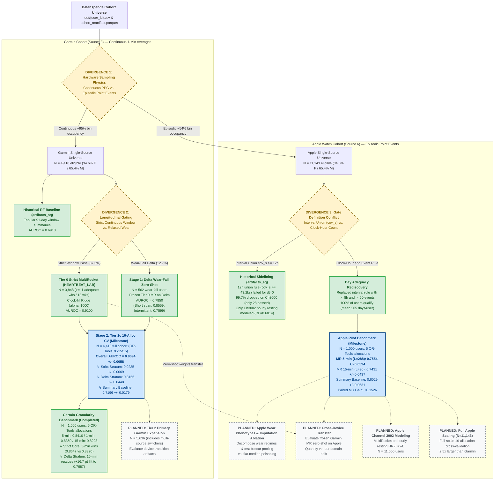

# Recorded-Salutation Prediction from Wearable Epoch Data

This repository evaluates predictive models of recorded salutation (codes 10 vs. 20) using wearable epoch time series from the German COVID-19 Data Donation (*Datenspende*).

Analyses span continuous optical photoplethysmography (Garmin Source 3, 1-min averages) and episodic point events (Apple Watch Source 6). Primary models utilize MultiRocket convolutional transforms combined with regularized linear heads, benchmarking sequence representations against tabular circadian and demographic summaries across balanced OR-Tools allocations.

---

## Executive Milestone Timeline

The table below traces the experimental progression, from early tabular baselines to high-resolution sequence modeling and cross-hardware divergence:

| Phase / Architectural Branch | Cohort & Scope | Model / Representation | Test AUROC | Key Milestone / Structural Insight |
| :--- | :--- | :--- | :---: | :--- |
| **1. Historical Tabular Baseline** | Pooled ($N = 20,485$) | Random Forest on 91-day statics | **0.7132** | Baseline tabular benchmark; marked class recall asymmetry. |
| ↳ *Strict Source-Specific RF* | Garmin ($N = 3,848$) | RF on feature dictionary | **0.6918** | Proved static demographic summaries underperform sequence representations. |
| **2. Garmin Sequence Revolution** | Garmin Strict ($N = 3,848$) | MultiRocket (first 40-day window) | **0.8565** | First proof that within-day sequence order outperforms statics (+0.14 AUROC). |
| ↳ *Full-History Scaling* | Garmin Strict ($N = 3,848$) | MultiRocket (all days, mean 425) | **0.9264** | Day budget is the strongest single lever measured; concave precision curve. |
| ↳ *Tier 0 Canonical Model* | Garmin Strict ($N = 3,848$) | MultiRocket + Ridge ($\alpha=1000$) | **0.9100** | Canonical 13-week continuous wear deployment benchmark. |
| **3. Longitudinal Gate Relaxation** | Garmin Tier 1c ($N = 4,410$) | MultiRocket (10 OR-Tools splits) | **0.9094** | Relaxing continuous wear gate adds +562 users without degrading core performance. |
| ↳ *Strict Core Stratum* | Tier 1c Core ($n \approx 575$/fold) | MultiRocket on compliant wearers | **0.9235** | Core discrimination remains firmly $>0.92$. |
| ↳ *Wear-Fail Delta Stratum* | Tier 1c Delta ($n \approx 87$/fold) | MultiRocket on wear-fail users | **0.8156** | Recovered from 0.7850 zero-shot through within-fold exposure. |
| **4. Hardware Granularity Benchmark** | Garmin Benchmark ($N = 1,000$) | MultiRocket 5-min ($L = 288$) | **0.8410** | Gold standard balance of temporal fidelity and compute (84.7s). |
| ↳ *1-Minute Raw Grid* | Garmin Benchmark ($N = 1,000$) | MultiRocket 1-min ($L = 1,440$) | **0.8350** | Strict matches 5m (0.8645); Delta collapses (0.6022) under median flatlines. |
| ↳ *15-Minute Boxcar Grid* | Garmin Benchmark ($N = 1,000$) | MultiRocket 15-min ($L = 96$) | **0.8228** | Rescues intermittent Delta wear (+0.1665 lift to **0.7687**) via physical pooling. |
| **5. Hardware Divergence: Apple Watch** | Apple Pilot ($N = 1,000$) | MultiRocket 5-min ($L = 288$) | **0.7554** | **+0.1526 paired gain** over static summaries (**0.6029**) on episodic point events. |
| ↳ *15-Minute Downsampling* | Apple Pilot ($N = 1,000$) | MultiRocket 15-min ($L = 96$) | **0.7431** | Disproved data-absence myth: 100% qualify under clock-hour rules. |

---

## Visual Experiment Worktree & Lineage

The visual worktree below maps the lineage of all completed, active, and planned investigations, illustrating where experiments diverged across hardware sampling regimes and cohort inclusion gates:

### Key Synthesis Documents & Provenance

The [`learnings/`](learnings/) directory captures architectural syntheses, lineage diagrams, and future designs derived from the milestone experiments:

- [`learnings/wear_phenotypes_and_missingness_synthesis.md`](learnings/wear_phenotypes_and_missingness_synthesis.md)  
  *Derived from:* **Tier 1c Garmin Full Cohort Relaxation** ($N=4,410$), **Apple Watch Pilot Benchmark** ($N=1,000$), and **Garmin Temporal Binning Benchmark** ($N=1,000$). Decomposes why 76.9% of relaxed-cohort users are intermittent wearers, analyzes watchOS adaptive sampling physics, and explains why 15-minute boxcar pooling rescues MultiRocket from flat-median convolution poisoning (+16.7 pt lift).
- [`learnings/future_experiments_backlog.md`](learnings/future_experiments_backlog.md)  
  *Derived from:* Findings in the **Apple Watch Pilot** and **Garmin Binning** experiments. Specifies prioritized follow-up designs: Apple wear phenotype decomposition, smooth spline vs. mask imputation, and cross-hardware zero-shot transfer.
- [`learnings/experiment_lineage_worktree.md`](learnings/experiment_lineage_worktree.md)  
  *Derived from:* Repository-wide audit mapping all 21 completed and planned experiments across hardware sampling physics and longitudinal gating divergences.
- [`learnings/multirocket_garmin_synthesis.md`](learnings/multirocket_garmin_synthesis.md)  
  *Derived from:* The **HEARTBEAT_LAB Tier 0** strict continuous wear deployment model ($N=3,848$, AUROC $0.9100$).

---

## Comprehensive Experiment Ledger

| Experiment | Scope & Design | Model / Features | Test AUROC | Key Finding / Artifact |
| :--- | :--- | :--- | :---: | :--- |
| **--- Primary Sequence Milestones (MultiRocket & Scaling) ---** | | | | |
| [Days scaling](experiments/temporal_garmin/results/DAYS_SCALING_REPORT.md) | $N = 3,848$ Garmin, 10 allocations | MultiRocket sampled across full history ($k \to \text{all}$) | **0.9264** | Strongest single lever measured (+0.090 vs. 40-day MR, +0.070 over 40-day ensemble); concave precision curve. |
| [Tier 0 Canonical Model](HEARTBEAT_LAB/README.md) | $N = 3,848$ Garmin Strict, $\ge 11$/13 wks | MultiRocket 5m + Ridge ($\alpha=1000$) | **0.9100** | Canonical continuous-wear baseline; established $\approx 0.91$ floor. |
| [Tier 1c Full Cohort Relaxation](HEARTBEAT_LAB/README.md) | $N = 4,410$ Garmin (+562 wear-fail), 10 allocs | MultiRocket 5m on full cohort | **0.9094 ± 0.0058** | Core remains 0.9235; delta wear-fail stratum recovered to 0.8156 (+0.1898 over summary 0.7196). |
| [Garmin Temporal Binning](experiments/garmin_temporal_binning/README.md) | $N = 1,000$ Garmin, 5 allocations | MultiRocket 1m vs. 5m vs. 15m | **5m: 0.8410** 1m: 0.8350 15m: 0.8228 | Strict favors 5m (0.8647 vs. 0.8320); Delta favors 15m (0.7687 vs. 0.6022, +16.7 pt lift). |
| [Apple Watch MultiRocket Pilot](experiments/apple_pilot_multirocket/README.md) | $N = 1,000$ Apple Watch (Source 6), 5 allocs | MultiRocket 5m vs. 15m vs. Summary | **MR 5m: 0.7554 ± 0.0594** MR 15m: 0.7431 Summary: 0.6029 | MultiRocket yields +0.1526 paired gain over statics despite ~54% episodic bin occupancy. |
| [Delta Zero-Shot Transfer](HEARTBEAT_LAB/artifacts/eval_delta_562/) | $N = 562$ wear-fail Garmin users | Frozen Tier 0 MultiRocket evaluated on delta | **0.7850** | Short-tenure users retain 0.8559; chronic intermittent wearers drop to 0.7599. |
| [Temporal representations](experiments/temporal_garmin/results/REPORT.md) | $N = 3,848$ Garmin, first-40-day window | MultiRocket + HYDRA + Profile | **0.8565** | Value shuffling reduces AUROC to 0.6643, proving within-day sequence order is predictive. |
| [Selective classification](experiments/temporal_garmin/results/selective_classification.md) | $N = 3,848$ Garmin, 10 allocations | MultiRocket prediction confidence thresholding | Risk-coverage curves | Risk monotonic in abstention; trade-off quantified across coverage tiers. |
| **--- Circadian, Day-Scale & Recording Structure Ablations ---** | | | | |
| [Day-scale modelling](experiments/dayscale_garmin_2026-09-21/results/REPORT.md) | $N = 3,848$ Garmin, single-day aggregation | Aggregated per-day curve predictions ($k=1 \to 32$) | **0.6653 → 0.7302** | Scaling individual days improves performance; personal baseline features help most at small $k$. |
| [R1a circadian features](experiments/r1a_circadian_garmin_2026-09-21/results/REPORT.md) | $N = 3,848$ Garmin | 35 hourly profile / cosinor components | **0.7434 → 0.7470** | Small positive increments (+0.0036) over static baseline; survives coverage residualization. |
| [R1a with balanced allocator folds](experiments/r1a_allocfolds_garmin_2026-09-21/results/REPORT.md) | $N = 3,848$ Garmin, 10 allocations | Demographic-balanced OR-Tools folds | **0.7415 → 0.7509** | Both circadian and residualized increments remain positive across all 10 allocations. |
| [R1b date-aware circadian](experiments/r1b_dateaware_garmin_2026-09-21/results/REPORT.md) | $N = 3,848$ Garmin, first 40 adequate days | Chronological per-day curves | **0.6589 → 0.6782** | Day-level gain +0.0193 survives linear coverage adjustment; participant baseline reaches 0.7513. |
| [Recording structure](experiments/recording_structure_garmin/results/REPORT.md) | $N = 3,848$ Garmin, 8 arms × 3 allocations | Binary mask / event-count sequences | **0.6166 → 0.6332** | Temporal masks alone carry signal (+0.035 over shuffled controls); concatenation gives −0.010. |
| [Filling sensitivity](experiments/filling_sensitivity_garmin/results/REPORT.md) | $N = 3,848$ Garmin, 4 fills × 3 allocations | Clock median vs. global vs. linear vs. PCHIP | **0.8464 → 0.8485** | Within-grid interpolation reaches <0.5% of bins; no material sensitivity on compliant wear. |
| **--- Foundational Random Forest & Feature Engineering Studies ---** | | | | |
| [Strict source-specific models](experiments/artifacts_sq/sidequest_report.md) | Garmin 3,848, Apple 4,446, Samsung 541 | Source-tailored tabular RF (91-day windows) | Garmin **0.6918** Apple **0.6814** Samsung **0.6289** | Epoch summaries outperform demographics; useful representations differ across hardware sources. |
| [Informative recording / missingness](experiments/2026-09-20_informative_recording_features/README.md) | Ungated cohort $N = 25,784$ | Recording volume + value models | **0.6826 → 0.7239** | Explicit recording features add +0.0167 beyond values; native NaNs show no gain over median fills. |
| [Continuous age versus age groups](experiments/age_vs_agegroup_garmin_2026-09-20/results/REPORT.md) | Garmin single-source | Continuous age vs. 5-year binned brackets | **0.7445 → 0.7475** | Paired gain +0.0029 (interval [−0.0008, +0.0067]); compact representation without superiority. |
| [OR-Tools 50/50, flipped](experiments/2026-09-21_ortools_source_50_50_salutation_rf/PLAN.md) | Ungated cohorts (Garmin, Apple, Samsung) | Age/BMI/salutation-balanced allocation | Garmin **0.7290 / 0.7094** Apple **0.6875 / 0.6787** | Established directionally balanced evaluation; fixed 100 trees and `max_depth=10`. |
| [RF tuning](experiments/artifacts_sq/tuned_500_comparison.md) | Garmin source-specific matrix | Tree depth and leaf regularization grid | Matrix width reduction | Established standard RF config: `max_features=0.4`, `min_samples_leaf=10`, balanced subsample. |
| [Feature selection](experiments/artifacts_sq/fsplit/feat_sel_report.md) | Garmin source-specific, 30 repeated splits | Correlation pruning, mutual info, top-k | Matrix width reduced | Pruning reduced width without performance loss; selected feature subsets proved unstable. |
| [Feature engineering](experiments/artifacts_sq/feng/feat_eng_report.md) | Garmin source-specific | Interactions, channel ratios, rolling diffs | Increment **$\le +0.0034$** | Ratios and rolling differences gave minor increments whose confidence intervals crossed zero. |
| [Pooled v1](reports/REPORT.md) | $N = 20,485$ participants | Default RF on pooled demographic/epoch summaries | **0.7132** | Earliest baseline; marked class recall asymmetry (balanced accuracy 0.5896). |
| [Pooled v2](experiments/artifacts_v2/model_report.md) | $N = 20,485$ participants | Added source indicators and exclusion updates | **0.6833** | Shifted cohort composition prevented attributing change to features alone. |

The informative-recording and OR-Tools result summaries above reflect published figures from each experiment's documentation. Output directories containing participant-level artifacts remain excluded from Git.

---

## What the Results Support

The primary methodological finding is that **representing within-day heart rate sequences substantially outperforms scalar summaries**. On matched data, temporal sequence models reach 0.8565 test AUROC versus 0.7157 for summary ridge regressions (+0.14 paired increment). Hourly and circadian features yield smaller positive increments. These results demonstrate empirical predictability in the evaluated cohorts without establishing the physiological origin of the signal.

**Expanding the per-participant day budget is the largest single lever identified.** Sampling days from each participant's full adequate history instead of the initial 40-day window lifts single-arm MultiRocket test AUROC from 0.8361 to 0.9264 (**+0.090 over the 40-day single-arm baseline, and +0.070 over the best 40-day combined ensemble of 0.8565**). The empirical budget curve is concave, bounded at the endpoint between a $1/\sqrt{k}$ moment-precision extrapolation (asymptote $\approx 0.93$) and a log-linear trajectory ($\approx 0.99$); because no fixed point above $k=80$ was directly measured, the theoretical ceiling remains unobserved. This gain is transform-specific: hourly profile features gain +0.06 and summary RF gains +0.04 across the same horizon. Day sampling strategy matters primarily for sequence transforms: random-$k$ sampling outperforms chronological first-$k$ within windowed data (+0.021 test at $k=4$), and full-history sampling adds $\approx +0.02$ at matched $k$.

**Recording structure carries predictive signal in its own right.** Binary mask and event-count sequences achieve approximately 0.62–0.63 test AUROC. Shuffling controls implicate temporal arrangement while jointly disrupting local sequence order and diurnal clock alignment. The heart-rate value shuffle preserves observation masks while randomizing value order and value-to-time alignment, which does not isolate interactions between heart rate, sampling frequency, and participant recording habits. These AUROC differences do not identify physiological information fractions.

**Standard filling conventions have limited influence on aggregate AUROC for dense, compliant wearers.** PCHIP and linear interpolation yield nearly identical test rankings (Spearman 0.9993–0.9995). However, interpolation modifies the fill rule at only 197,148 of 5,089,133 missing bins ($\approx 0.44\%$ of the input matrix); global median filling represents a broader intervention, yet its slight test advantage reverses under validation. Clock-bin medians remain the appropriate reference for continuous wearers. Conversely, on fragmented or episodic wear (Garmin delta wear-fail and Apple Watch), temporal downsampling (15-min boxcar pooling) rescues convolutions from flat-median poisoning, gaining +0.1665 AUROC over 1-minute grids.

Feature hygiene safely reduces matrix width. Evaluated feature-selection and feature-engineering procedures did not demonstrate generalizable performance improvements. Continuous age provides a compact alternative to age brackets without establishing clear superiority. Informative recording studies identify complementarity between recording volume and sensor values, though differing population gates prevent transferring those conclusions directly to the strict Garmin sequence models.

Informative recording analyses confirm that observation patterns predict recorded salutation. They do not demonstrate a missing-not-at-random (MNAR) mechanism or establish out-of-sample performance where salutation is unrecorded. Protocol specifications are detailed in the [informative recording plan](plans/CODEX_INFORMATIVE_RECORDING_FEATURE_PLAN_2026-09-20.md); [MNAR_PLAN.md](plans/MNAR_PLAN.md) represents an earlier exploratory draft.

---

## Interpretation Qualifications

- **Day counts reflect adequate data density, not elapsed calendar follow-up.** Sampling $k$ days across a record does not imply prospective calendar follow-up. Chronological first-$k$ evaluations remain conditional on eventual cohort eligibility. Forty adequate days do not equal forty consecutive calendar days.
- **The full-history scaling endpoint is conditional on long-tenure engagement.** Full-history evaluations rely on each participant's available pool (80–979 days, mean 425), which correlates with sustained participant engagement. Static controls indicate that coverage confounding is modest (+0.005 on profiles vs. +0.041 on MultiRocket over the 80-to-all transition) but do not eliminate it. The 0.9264 endpoint used a single kernel draw and fixed regularization ($\alpha=1000$), representing an empirical benchmark conditional on $\ge 80$ adequate days rather than an export-wide population average.
- **Coverage residualization is a predictive adjustment, not causal deconfounding.** Observed increments following linear adjustments for hourly coverage shares and volume describe statistical associations within training distributions; they do not establish causal independence.
- **Cosinor regressions are descriptive harmonic fits.** Cosinors use weighted harmonic regressions on hourly means with 24-, 12-, and 8-hour components without detrending or prior interpolation. Missing hours receive zero fitting weight.
- **Filling sensitivity conclusions depend on pipeline architecture.** Interpolation evaluations retained recording features and refit ridge heads. Because optimal ridge penalties varied across fill strategies, ranking differences cannot be attributed solely to impute values.
- **Evaluation designs differ across development phases.** Early explorations utilized repeated label-stratified splits, whereas modern milestones utilize demographic-balanced OR-Tools allocations. Intervals describe model and split randomization conditional on observed cohorts rather than prospective external validation.
- **The current synthesis supersedes historical working drafts.** The [Markdown meta-report](reports/recorded_salutation_meta_report_2026-09-22.md) and [`learnings/wear_phenotypes_and_missingness_synthesis.md`](learnings/wear_phenotypes_and_missingness_synthesis.md) provide the authoritative scientific synthesis, distinguishing verified empirical metrics from historical working hypotheses.

---

## Research Direction

- **Broader Imputation Sensitivity & Wear Phenotyping:** Evaluate dependence on gap duration, nocturnal missingness, and sampling density across larger populations. Separate wearable sensor reconstruction from downstream target estimation.
- **Multi-Channel Representation Modeling:** Combine Channel 3000 heart rate with step/activity channels and resting/sleep metrics under matched day budgets and cross-validation allocations.
- **Cross-Device Hardware Transfer:** Evaluate frozen Garmin models zero-shot on episodic Apple Watch data to quantify domain shift between continuous PPG and episodic event triggering.
- **Dual-Channel MultiRocket for Episodic Sampling:** Evaluate dual-channel inputs (Channel 0 = HR trajectory, Channel 1 = binary observation mask) on Apple Watch and relaxed Garmin cohorts to eliminate flat-median convolutional artifacts.

---

## Cohort Allocation Package

The repository includes [`cohort_allocator`](cohort_allocator/README.md), an OR-Tools integer programming package that generates balanced, leakage-free cross-validation partitions across arbitrary combinations of continuous demographic variables, categorical strata, and cluster constraints.
