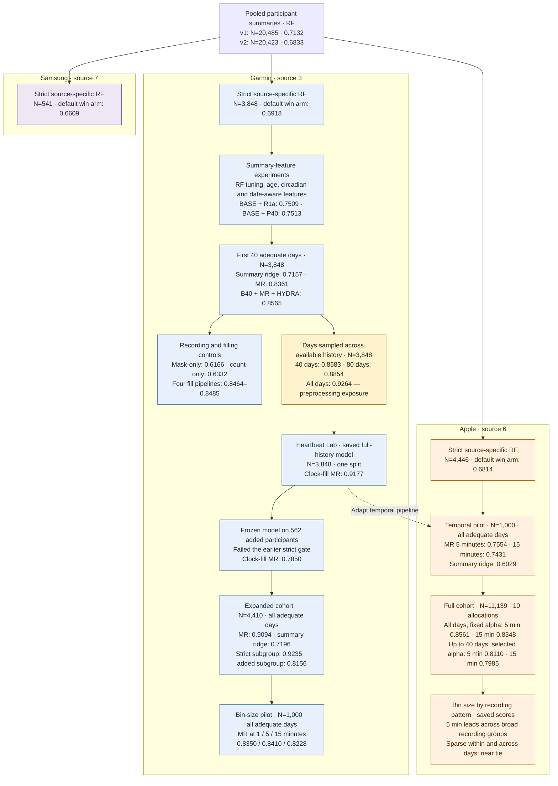

# Recorded salutation prediction from wearable data

This repository studies how well wearable heart-rate records predict recorded salutation in the German COVID-19 Data Donation study. The original analysis maps `10 → 0/F` and `20 → 1/M`. The target is a recorded profile field, not a validated measure of biological sex or gender identity.

The work started with participant summaries and random forests, then moved to within-day sequences. Later experiments expand the Garmin cohort, vary the time-bin size, and extend Apple modeling from a 1,000-person pilot to 11,139 participants. The latest exploration compares bin sizes within Apple recording-pattern groups using saved predictions.

Start with the [experimental work tree](#experimental-work-tree) below. Use the [results reference](reports/results_reference.md) for definitions and comparisons, or the [experiment index](learnings/experiment_lineage_worktree.md) to locate a study’s report and code.

## Device sources

| Source in the data | Records used here | Experimental cohorts |
|---|---|---|
| **Garmin — source 3** | HR interval records, including one-minute buckets; temporal models use type 3000 HR | 3,848 strict participants; expanded cohort of 4,410; 1,000-person binning pilot |
| **Apple — source 6** | HR point events; temporal models use type 3000 HR, averaged into 5- or 15-minute bins | 4,446 in the historical strict RF cohort; 1,000-person temporal pilot; full temporal cohort of 11,139 qualified from 11,143 candidates |
| **Samsung — source 7** | Core-channel participant summaries in the source-specific RF experiments | 541 in the historical strict RF cohort |

These labels identify the recorded data source, not a particular hardware model. The historical RF work uses HR and resting-HR channels (3000/3001/3002). Its strict gate can be passed on any one core channel. The temporal studies model HR sequences and use their own adequate-day rules; see [cohort definitions](reports/results_reference.md#cohorts).

## Experimental work tree

Numbers below are **test AUROCs**. Repeated-holdout results are means; the saved Lab model has one split. Arrows show how the work developed, not matched comparisons between every connected experiment. MR means MultiRocket, including the summary features used in that experiment. B40, R1a, and P40 name feature blocks; their definitions are in the [model and experiment names](reports/results_reference.md#model-and-experiment-names).

The [full experiment index](learnings/experiment_lineage_worktree.md) links the code and outputs, including feature selection, informative recording, day-level aggregation, and the broader 50/50 source experiments. The [results reference](reports/results_reference.md) gives the split designs and numerical tables.

## What the experiments show

### Within-day sequences

In the first-40-day Garmin comparison, MultiRocket reaches **0.8361**, compared with **0.7157** for summary ridge. Combining B40, MultiRocket, and HYDRA gives **0.8565**. B40 is the 305-feature summary and observation-mask block.

This comparison fits preprocessing within each allocation, but reuses regularization selected on allocation-0 validation; some later test participants belonged to that validation set.

### History length

Sampling 40 and 80 adequate days across the available record gives **0.8583 ± 0.0115** and **0.8854 ± 0.0115**, respectively. These are different inputs from the first 40 adequate days.

The historical all-days result, **0.9264 ± 0.0055**, reuses preprocessing fitted on allocation-0 training participants across later allocations. Later test participants therefore contributed to that preprocessing. Its effect on AUROC is unknown. The separate saved Lab model scores **0.9177** on one test split with training-participant preprocessing; it does not measure the bias in the historical endpoint.

### Garmin cohort expansion

Across ten repeated holdouts of 4,410 participants, MR scores **0.9094 ± 0.0058**, versus **0.7196 ± 0.0179** for summary ridge. The 562 added participants failed the earlier longitudinal gate. Their mean test AUROC after retraining is **0.8156 ± 0.0448**.

The frozen-model result of **0.7850** uses all 562 and a different fitted model, so the difference does not isolate the benefit of retraining.

### Garmin and Apple bin sizes

Each pilot uses 1,000 participants, five repeated holdouts, and all adequate days. Mean available history is 395.5 days for Garmin and 264.9 for Apple.

| Model | Garmin pilot AUROC, mean ± SD | Apple pilot AUROC, mean ± SD |
|---|---:|---:|
| MR, 1-minute bins | 0.8350 ± 0.0369 | Not evaluated |
| MR, 5-minute bins | 0.8410 ± 0.0380 | 0.7554 ± 0.0594 |
| MR, 15-minute bins | 0.8228 ± 0.0411 | 0.7431 ± 0.0437 |
| Summary ridge | 0.7143 ± 0.0360 | 0.6029 ± 0.0631 |

In Garmin's added-participant group, fifteen-minute bins gain **+0.0934 ± 0.0761 AUROC over five minutes** (0.7687 versus 0.6753), and **+0.1665 ± 0.1743 over one minute**. In the strict group, five minutes instead gains **+0.0326 ± 0.0081 over fifteen minutes**. The added group combines intermittent records and short, densely recorded histories; the saved binning results do not split those two patterns. See the [Garmin](experiments/garmin_temporal_binning/README.md) and [Apple pilot](experiments/apple_pilot_multirocket/README.md) reports.

### Full Apple cohort and recording patterns

The [full Apple benchmark](experiments/apple_cohort_scaling/README.md), completed on October 14, uses **11,139 participants** and ten 7,797/1,671/1,671 train/validation/test allocations. Mean available history is **266.4 adequate days**. MultiRocket includes the summary features.

| Representation and history | Fixed α = 1000 test AUROC | Validation-selected α test AUROC |
|---|---:|---:|
| MR, all days, 5 min | **0.8561 ± 0.0111** | 0.8553 ± 0.0123 |
| MR, all days, 15 min | 0.8348 ± 0.0079 | 0.8378 ± 0.0106 |
| MR, first up to 40 adequate days, 5 min | 0.7918 ± 0.0148 | **0.8110 ± 0.0131** |
| MR, first up to 40 adequate days, 15 min | 0.7636 ± 0.0113 | 0.7985 ± 0.0097 |
| Summary ridge, all days, 5 min | 0.6474 ± 0.0180 | 0.6468 ± 0.0151 |

Adding MultiRocket to the full-history summaries gains **+0.2087 AUROC** at fixed alpha. Selecting stronger regularization helps the capped-history arms: +0.0193 at five minutes and +0.0350 at fifteen minutes. With alpha selected separately for both histories, the full-history advantage at five minutes is **+0.0442 ± 0.0122**.

Does sparse recording favor fifteen-minute bins in Apple? The [saved-score exploration](experiments/apple_cohort_scaling/BINNING_BY_RECORDING.md) separates within-day bin occupancy, continuity across adequate dates, and history length:

- Five minutes leads on average in every broad low/middle/high occupancy, continuity, and history group, under both alpha rules.
- With **low occupancy and low continuity together**, the full-history selected-alpha scores are nearly tied: **0.8228 at five minutes versus 0.8170 at fifteen minutes**. The five-minute advantage is +0.0058, compared with +0.0175 overall.
- Sparse within-day readings alone do not remove the advantage: the **high-continuity, low-occupancy** group scores **0.8700 versus 0.8454** (+0.0246).
- **Shorter-history, high-occupancy** participants score **0.8130 versus 0.8073** (+0.0056); with first-up-to-40-day inputs, both score approximately **0.8000**. Their median adequate-day continuity is about 98%.

Apple therefore suggests that the combination of recording patterns matters, but shows no Garmin-sized fifteen-minute gain in the examined groups. Coarsening raises overall observed-bin occupancy from **54.0% to 68.3%**, while five-minute discrimination remains higher. A useful next comparison is to vary filling or add explicit mask channels within these same groups.

Here, **± is sample SD across repeated holdouts**. The expanded Garmin benchmark and both pilots save aggregate metrics; the full Apple benchmark also saves participant predictions, enabling the recording-pattern comparisons above. The [October 14 audit](reports/results_audit_2026-10-14.md) covers the earlier experiments.

## Read further

- [Results reference](reports/results_reference.md): cohorts, history budgets, model comparisons, and evaluation designs.
- [Experiment index](learnings/experiment_lineage_worktree.md): implementation and result paths for each study.
- [Results audit](reports/results_audit_2026-10-14.md): verified metrics, corrections, and remaining limits.
- [Model notes](learnings/multirocket_garmin_synthesis.md) and [recording-pattern notes](learnings/wear_phenotypes_and_missingness_synthesis.md): how the representations work and what the controls can establish.
- [Heartbeat Lab](HEARTBEAT_LAB/README.md): saved models and the local prediction-inspection app.
- [Follow-up experiments](learnings/future_experiments_backlog.md): proposed work, separate from the completed results above.
- [Documentation guide](learnings/README.md): how to read the reports and maintain experiment summaries.

## Repository layout

| Path | Contents |
|---|---|
| `src/` | Pooled analysis and source-specific RF code in `src/sidequest/` |
| `experiments/` | Individual studies, plans, implementations, reports, metrics, and local caches |
| `HEARTBEAT_LAB/` | Saved models, later cohort experiments, and the local inspection app |
| `cohort_allocator/` | OR-Tools allocation package |
| `reports/` | Results reference, audit, and historical meta-reports |
| `learnings/` | Experiment index, method explanations, and proposed follow-ups |
| `plans/` | Earlier protocols |
| `figs_ppt/` | Presentation figures and their source scripts |
| `data/`, `out/` | Local input tables and participant epoch exports |

Many inputs, predictions, caches, and fitted models are local or Git-ignored. A checkout alone cannot reproduce every result.

The [September 22 meta-report](reports/recorded_salutation_meta_report_2026-09-22.md) covers the earlier RF and circadian work. It predates the temporal and expanded-cohort results. In `temporal_garmin/results/`, unversioned files contain corrected results; `_v1` and `_v1mrbug` files preserve earlier runs with documented defects.
