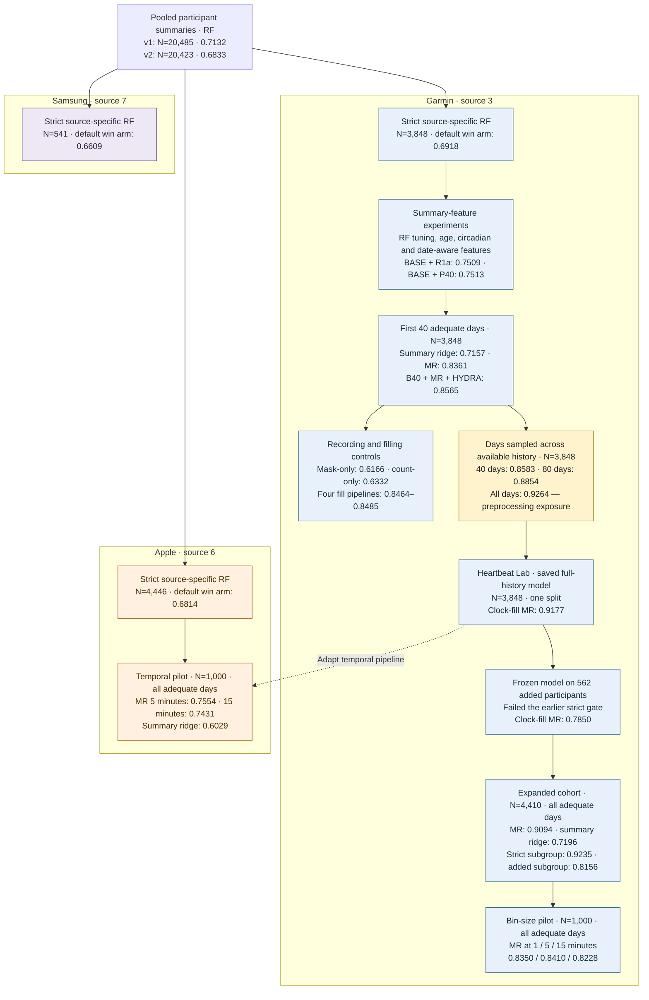

# Recorded salutation prediction from wearable data

This repository studies how well wearable heart-rate records predict recorded salutation in the German COVID-19 Data Donation study. The original analysis maps `10 → 0/F` and `20 → 1/M`. The target is a recorded profile field, not a validated measure of biological sex or gender identity.

The work started with participant summaries and random forests, then moved to within-day sequences. Most temporal experiments use Garmin data. Later experiments expand the Garmin cohort, vary the time-bin size, and test MultiRocket on Apple records.

## Device sources

| Source in the data | Records used here | Experimental cohorts |
|---|---|---|
| **Garmin — source 3** | HR interval records, including one-minute buckets; temporal models use type 3000 HR | 3,848 strict participants; expanded cohort of 4,410; 1,000-person binning pilot |
| **Apple — source 6** | HR point events; the temporal pilot uses type 3000 HR, averaged into 5- or 15-minute bins | 4,446 in the historical strict RF cohort; a separate 1,000-person temporal pilot sampled from 11,143 eligible single-source participants |
| **Samsung — source 7** | Core-channel participant summaries in the source-specific RF experiments | 541 in the historical strict RF cohort |

These labels identify the recorded data source, not a particular hardware model. The historical RF work uses HR and resting-HR channels (3000/3001/3002). Its strict gate can be passed on any one core channel. The temporal studies model HR sequences and use their own adequate-day rules; see [cohort definitions](reports/results_reference.md#cohorts).

## Experimental work tree

Numbers below are **test AUROCs**. Repeated-holdout results are means; the saved Lab model has one split. Arrows show how the work developed, not matched comparisons between every connected experiment. MR means MultiRocket, including the summary features used in that experiment.

The [full experiment index](learnings/experiment_lineage_worktree.md) links the code and outputs, including feature selection, informative recording, day-level aggregation, and the broader 50/50 source experiments. The [results reference](reports/results_reference.md) gives the split designs and numerical tables.

## What the experiments show

**Within-day sequence features improve on the tested summary baselines.** In the first-40-day Garmin comparison, MultiRocket reaches **0.8361**, compared with **0.7157** for summary ridge. Combining B40, MultiRocket, and HYDRA gives **0.8565**. B40 is the 305-feature summary and observation-mask block. This comparison fits preprocessing within each allocation, but reuses regularization selected on allocation-0 validation; some later test participants belonged to that validation set.

**Longer histories help in the fixed-budget Garmin experiments.** Sampling 40 and 80 adequate days across the available record gives **0.8583 ± 0.0115** and **0.8854 ± 0.0115**, respectively. These are different inputs from the first 40 adequate days. The historical all-days result, **0.9264 ± 0.0055**, reuses preprocessing fitted on allocation-0 training participants across later allocations. Later test participants therefore contributed to that preprocessing. Its effect on AUROC is unknown. The separate saved Lab model scores **0.9177** on one test split with training-participant preprocessing; it does not measure the bias in the historical endpoint.

**The expanded Garmin cohort retains a large gain over summary ridge.** Across ten repeated holdouts of 4,410 participants, MR scores **0.9094 ± 0.0058**, versus **0.7196 ± 0.0179** for summary ridge. The 562 added participants failed the earlier longitudinal gate. Their mean test AUROC after retraining is **0.8156 ± 0.0448**. The frozen-model result of **0.7850** uses all 562 and a different fitted model, so the difference does not isolate the benefit of retraining.

**The Apple pilot also gains from sequence features; bin-size effects vary by cohort.** Each pilot uses 1,000 participants, five repeated holdouts, and all adequate days. Mean available history is 395.5 days for Garmin and 264.9 for Apple.

| Model | Garmin pilot AUROC, mean ± SD | Apple pilot AUROC, mean ± SD |
|---|---:|---:|
| MR, 1-minute bins | 0.8350 ± 0.0369 | Not evaluated |
| MR, 5-minute bins | 0.8410 ± 0.0380 | 0.7554 ± 0.0594 |
| MR, 15-minute bins | 0.8228 ± 0.0411 | 0.7431 ± 0.0437 |
| Summary ridge | 0.7143 ± 0.0360 | 0.6029 ± 0.0631 |

The Apple 5-minute model improves on summary ridge by **+0.1526 ± 0.0423** in paired comparisons. In the Garmin pilot's added-participant subgroup, 15-minute bins score **0.7687**, versus **0.6022** at one minute. That subgroup contains only 15–24 test participants per allocation; the paired difference is **+0.1665 ± 0.1743**. See the [Garmin](experiments/garmin_temporal_binning/README.md) and [Apple](experiments/apple_pilot_multirocket/README.md) reports. These pilots are not matched across devices and do not establish a hardware ranking or explain the cause of the bin-size effects.

Here, **± is sample SD across repeated holdouts**, not a confidence interval. Test sets overlap across allocations. The expanded-cohort benchmark and both pilots save aggregate metrics without participant predictions, which limits independent verification. The [audit](reports/results_audit_2026-10-14.md) distinguishes reconstructed metrics from aggregate checks. All results remain exploratory evidence from repeatedly studied participants, rather than external validation or validation among people with missing salutation.

## Read further

- [Results reference](reports/results_reference.md): cohorts, history budgets, model comparisons, and evaluation designs.
- [Experiment index](learnings/experiment_lineage_worktree.md): implementation and result paths for each study.
- [Results audit](reports/results_audit_2026-10-14.md): verified metrics, corrections, and remaining limits.
- [Model notes](learnings/multirocket_garmin_synthesis.md) and [recording-pattern notes](learnings/wear_phenotypes_and_missingness_synthesis.md): how the representations work and what the controls can establish.
- [Heartbeat Lab](HEARTBEAT_LAB/README.md): saved models and the local prediction-inspection app.
- [Follow-up experiments](learnings/future_experiments_backlog.md): proposed work, separate from the completed results above.

## Repository layout

| Path | Contents |
|---|---|
| `src/` | Pooled analysis and source-specific RF code in `src/sidequest/` |
| `experiments/` | Individual studies, plans, implementations, reports, metrics, and local caches |
| `HEARTBEAT_LAB/` | Saved models, later cohort experiments, and the local inspection app |
| `cohort_allocator/` | OR-Tools allocation package |
| `reports/` | Results reference, audit, and historical meta-reports |
| `learnings/` | Experiment map, method explanations, and proposed follow-ups |
| `plans/` | Earlier protocols |
| `figs_ppt/` | Presentation figures and their source scripts |
| `data/`, `out/` | Local input tables and participant epoch exports |

Many inputs, predictions, caches, and fitted models are local or Git-ignored. A checkout alone cannot reproduce every result.

The [September 22 meta-report](reports/recorded_salutation_meta_report_2026-09-22.md) covers the earlier RF and circadian work. It predates the temporal and expanded-cohort results. In `temporal_garmin/results/`, unversioned files contain corrected results; `_v1` and `_v1mrbug` files preserve earlier runs with documented defects.
