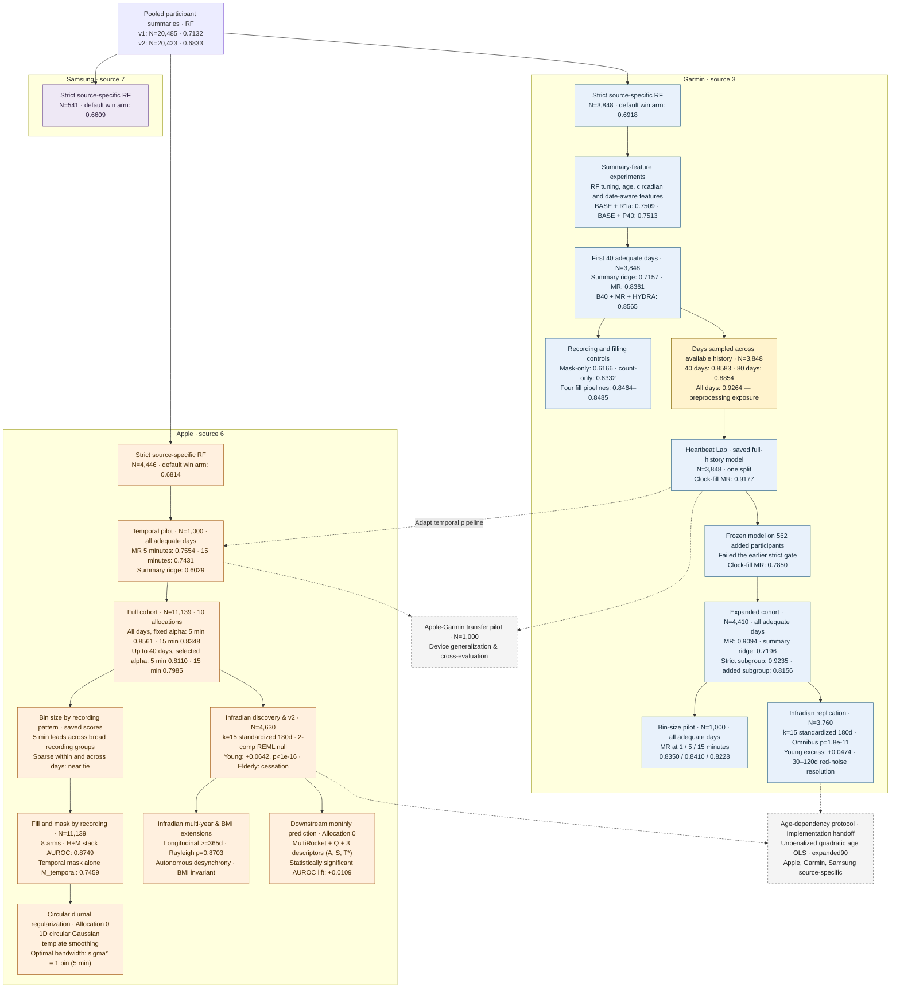

# Recorded salutation prediction from wearable data

This repository studies how well wearable heart-rate records predict recorded salutation in the German COVID-19 Data Donation study. The original analysis maps `10 → 0/F` and `20 → 1/M`. The target is a recorded profile field, not a validated measure of biological sex or gender identity.

The work started with participant summaries and random forests, then moved to within-day sequences. Later experiments expand the Garmin cohort, vary the time-bin size, and extend Apple modeling from a 1,000-person pilot to 11,139 participants. The latest exploration compares bin sizes within Apple recording-pattern groups using saved predictions.

Start with the [experimental work tree](#experimental-work-tree) below. Use the [results reference](reports/results_reference.md) for definitions and comparisons, or the [experiment index](learnings/experiment_lineage_worktree.md) to locate a study’s report and code.

## Device sources

| Source in the data | Records used here | Experimental cohorts |
|---|---|---|
| **Garmin — source 3** | HR interval records, including one-minute buckets; temporal models use type 3000 HR | 3,848 strict participants; expanded cohort of 4,410; 1,000-person binning pilot |
| **Apple — source 6** | HR point events; temporal models use type 3000 HR, averaged into 5- or 15-minute bins | 4,446 in the historical strict RF cohort; 1,000-person temporal pilot; full temporal cohort of 11,139 qualified from 11,143 candidates |
| **Samsung — source 7** | Core-channel participant summaries in the source-specific RF experiments | 541 in the historical strict RF cohort |

These labels identify the recorded data source, not a particular hardware model. The historical RF work uses HR and resting-HR channels (3000/3001/3002). Its strict gate can be passed on any one core channel. The temporal studies model HR sequences and use their own adequate-day rules; see [cohort definitions](reports/results_reference.md#cohorts).

## Experimental work tree

Numbers below are **test AUROCs**. Repeated-holdout results are means; the saved Lab model has one split. Arrows show how the work developed, not matched comparisons between every connected experiment. MR means MultiRocket, including the summary features used in that experiment. B40, R1a, and P40 name feature blocks; their definitions are in the [model and experiment names](reports/results_reference.md#model-and-experiment-names).

The [full experiment index](learnings/experiment_lineage_worktree.md) links the code and outputs, including feature selection, informative recording, day-level aggregation, and the broader 50/50 source experiments. The [results reference](reports/results_reference.md) gives the split designs and numerical tables.

## What the experiments show

### Within-day sequences

In the first-40-day Garmin comparison, MultiRocket reaches **0.8361**, compared with **0.7157** for summary ridge. Combining B40, MultiRocket, and HYDRA gives **0.8565**. B40 is the 305-feature summary and observation-mask block.

This comparison fits preprocessing within each allocation, but reuses regularization selected on allocation-0 validation; some later test participants belonged to that validation set.

### History length

Sampling 40 and 80 adequate days across the available record gives **0.8583 ± 0.0115** and **0.8854 ± 0.0115**, respectively. These are different inputs from the first 40 adequate days.

The historical all-days result, **0.9264 ± 0.0055**, reuses preprocessing fitted on allocation-0 training participants across later allocations. Later test participants therefore contributed to that preprocessing. Its effect on AUROC is unknown. The separate saved Lab model scores **0.9177** on one test split with training-participant preprocessing; it does not measure the bias in the historical endpoint.

### Garmin cohort expansion

Across ten repeated holdouts of 4,410 participants, MR scores **0.9094 ± 0.0058**, versus **0.7196 ± 0.0179** for summary ridge. The 562 added participants failed the earlier longitudinal gate. Their mean test AUROC after retraining is **0.8156 ± 0.0448**.

The frozen-model result of **0.7850** uses all 562 and a different fitted model, so the difference does not isolate the benefit of retraining.

### Garmin and Apple bin sizes

Each pilot uses 1,000 participants, five repeated holdouts, and all adequate days. Mean available history is 395.5 days for Garmin and 264.9 for Apple.

| Model | Garmin pilot AUROC, mean ± SD | Apple pilot AUROC, mean ± SD |
|---|---:|---:|
| MR, 1-minute bins | 0.8350 ± 0.0369 | Not evaluated |
| MR, 5-minute bins | 0.8410 ± 0.0380 | 0.7554 ± 0.0594 |
| MR, 15-minute bins | 0.8228 ± 0.0411 | 0.7431 ± 0.0437 |
| Summary ridge | 0.7143 ± 0.0360 | 0.6029 ± 0.0631 |

In Garmin's added-participant group, fifteen-minute bins gain **+0.0934 ± 0.0761 AUROC over five minutes** (0.7687 versus 0.6753), and **+0.1665 ± 0.1743 over one minute**. In the strict group, five minutes instead gains **+0.0326 ± 0.0081 over fifteen minutes**. The added group combines intermittent records and short, densely recorded histories; the saved binning results do not split those two patterns. See the [Garmin](experiments/garmin_temporal_binning/README.md) and [Apple pilot](experiments/apple_pilot_multirocket/README.md) reports.

### Full Apple cohort and recording patterns

The [full Apple benchmark](experiments/apple_cohort_scaling/README.md), completed on October 14, uses **11,139 participants** and ten 7,797/1,671/1,671 train/validation/test allocations. Mean available history is **266.4 adequate days**. MultiRocket includes the summary features.

| Representation and history | Fixed α = 1000 test AUROC | Validation-selected α test AUROC |
|---|---:|---:|
| MR, all days, 5 min | **0.8561 ± 0.0111** | 0.8553 ± 0.0123 |
| MR, all days, 15 min | 0.8348 ± 0.0079 | 0.8378 ± 0.0106 |
| MR, first up to 40 adequate days, 5 min | 0.7918 ± 0.0148 | **0.8110 ± 0.0131** |
| MR, first up to 40 adequate days, 15 min | 0.7636 ± 0.0113 | 0.7985 ± 0.0097 |
| Summary ridge, all days, 5 min | 0.6474 ± 0.0180 | 0.6468 ± 0.0151 |

Adding MultiRocket to the full-history summaries gains **+0.2087 AUROC** at fixed alpha. Selecting stronger regularization helps the capped-history arms: +0.0193 at five minutes and +0.0350 at fifteen minutes. With alpha selected separately for both histories, the full-history advantage at five minutes is **+0.0442 ± 0.0122**.

Does sparse recording favor fifteen-minute bins in Apple? The [saved-score exploration](experiments/apple_cohort_scaling/BINNING_BY_RECORDING.md) separates within-day bin occupancy, continuity across adequate dates, and history length:

- Five minutes leads on average in every broad low/middle/high occupancy, continuity, and history group, under both alpha rules.
- With **low occupancy and low continuity together**, the full-history selected-alpha scores are nearly tied: **0.8228 at five minutes versus 0.8170 at fifteen minutes**. The five-minute advantage is +0.0058, compared with +0.0175 overall.
- Sparse within-day readings alone do not remove the advantage: the **high-continuity, low-occupancy** group scores **0.8700 versus 0.8454** (+0.0246).
- **Shorter-history, high-occupancy** participants score **0.8130 versus 0.8073** (+0.0056); with first-up-to-40-day inputs, both score approximately **0.8000**. Their median adequate-day continuity is about 98%.

Apple therefore suggests that the combination of recording patterns matters, but shows no Garmin-sized fifteen-minute gain in the examined groups. Coarsening raises overall observed-bin occupancy from **54.0% to 68.3%**, while five-minute discrimination remains higher. A useful next comparison is to vary filling or add explicit mask channels within these same groups.

Here, **± is sample SD across repeated holdouts**. The expanded Garmin benchmark and both pilots save aggregate metrics; the full Apple benchmark also saves participant predictions, enabling the recording-pattern comparisons above. The [October 14 audit](reports/results_audit_2026-10-14.md) covers the earlier experiments.

### Female infradian rhythmicity across lifespan and biological autonomy

The [calibrated hypothesis testing](experiments/female_infradian_cycles_v2/results/REPORT.md) and [mechanistic extensions](experiments/female_infradian_extensions/results/REPORT.md) investigate whether 25–35-day periodic oscillations in daily resting heart rate proxy ($hr_{p10}$, 10th percentile of valid 5-minute bins) exhibit sex specificity and biological autonomy. The standardized protocol requires six consecutive 30-day blocks with $\ge 15$ qualified dates ($\ge 10.0$ hours wear) across a 180-day window ($[s, s+180)$); exactly 15 dates are sampled uniformly without replacement per block via deterministic SHA-256 seeding ($N_{\text{obs}} = 90$ dates). In the Apple Watch cohort ($N=11,139$), 4,630 participants qualify. Daily baseline residuals $e_0$ are projected orthogonal to linear calendar drift, weekday indicators, and four 6-hour clock coverage fractions. Harmonic cosinor regression searches 21 frequencies ($T \in [25.0, 35.0]\text{ days}$, step $0.5\text{ d}$), and excess score $E_i = S_i - \bar{S}_{\text{null}, i}$ is calibrated against $B=199$ subject-specific continuous calendar-time $\text{AR}(1)$ surrogate bootstrap realizations simulated on exact timestamps.

- **Lifespan trajectory and menopausal cessation**: An HC3 robust Wald test rejects the age $\times$ sex null hypothesis ($\text{Wald } \chi^2 = 56.76, \text{df}=2, p = 4.72 \times 10^{-13}$; Holm-adjusted $p = 9.44 \times 10^{-13}$). Young Adults (18–35y, female vs. male) exhibit a large excess score contrast: $\hat{\Delta}E = +0.0642$ ($\text{SE}_{\text{HC3}} = 0.0063$, 95% CI $[+0.0520, +0.0767]$, $\text{Wald } \chi^2 = 102.43, p_{\text{Holm}} < 10^{-16}$) and an amplitude difference of $+0.415\text{ bpm}$ (1.850 vs. 1.440 bpm, $\text{Wald } \chi^2 = 55.54, p = 9.16 \times 10^{-14}$). Middle-aged participants (36–55y) display an attenuated contrast: $\hat{\Delta}E = +0.0233$ ($\text{SE} = 0.0023, p_{\text{Holm}} < 10^{-16}$). In the Elderly cohort (56–80y), the contrast ceases: $\hat{\Delta}E = +0.0056$ ($\text{SE} = 0.0045$, 95% CI $[-0.0038, +0.0151]$, $\text{Wald } \chi^2 = 1.53, p_{\text{Holm}} = 0.2163$). Standardized overall contrast is $\hat{\Delta}_{\text{std}} = +0.0290$ ($\text{SE} = 0.0020, p < 10^{-16}$). Wear compliance shows no significant sex differences ($62.97\%$ female vs. $63.17\%$ male occupancy in young adults, $p = 0.759$) and yields zero excess score ($p = 0.759$).
- **Multi-year longitudinal stability**: Sliding 90-day window Lomb-Scargle spectrograms ($S=15\text{ days}$) across participants with $\ge 365$ days continuous history ($N=1,323$) demonstrate that reproductive-age females exhibit low period drift (median IQR $\Delta T_{\text{drift}} = 10.0\text{ days}$ vs. $18.0\text{ days}$ in age-matched males and $18.25\text{ days}$ in elderly females) and elevated target-band persistence ($35.0\%$ in females vs. $21.2\%$ in males). Wear occupancy persistence remains at chance level across all groups ($19.8\%\text{--}21.1\%$).
- **Circular acrophase uniformity**: Rayleigh tests of circular uniformity on calendar-epoch acrophases $\Phi_{\text{cal}}$ in reproductive females ($N=502$) fail to reject uniformity for resting HR ($Z = 0.1391, p = 0.8703$) and nocturnal HR ($p = 0.3759$). This uniform distribution across calendar time rules out lunar, seasonal, or collective environmental synchronization, confirming autonomous endogenous desynchrony.
- **Metabolic adiposity invariance**: Analysis across four WHO BMI classes (Underweight $N=19$, Normal $N=296$, Overweight $N=123$, Obese $N=64$) indicates that resting infradian amplitude is invariant to adiposity (Kruskal-Wallis $H = 1.8261, \text{df}=3, p = 0.6093$; period $H = 3.2462, p = 0.3552$). Multivariable ANCOVA with HC3 standard errors confirms no significant attenuation in overweight ($\beta = -0.0566\text{ bpm}, p_{\text{HC3}} = 0.4037$) or obese ($\beta = -0.0365\text{ bpm}, p_{\text{HC3}} = 0.6844$) individuals.

### Cross-device infradian replication on Garmin Tier 1c

The [cross-device replication study](experiments/garmin_infradian_replication/REPORT.md) evaluates external validity by applying the standardized $k=15$ protocol ($N_{\text{obs}}=90$ dates across 180 days) to the independent single-source Garmin Tier 1c cohort ($N=4,410$ manifest, $N=3,760$ qualified participants; $\ge 8$ clock hours and $\ge 60$ raw HR events per qualified day). Null calibration uses a two-component continuous autoregressive model ($\Sigma_{jk} = s_1 \phi_1^{|t_k - t_j|} + s_2 \phi_2^{|t_k - t_j|}$, $\phi_2 \in \{0.980, 0.995\}$) fitted via restricted maximum likelihood (REML) on baseline-projected coordinates, accounting for low-frequency baseline drift alongside daily autocorrelation.

- **Confirmatory HC3 Wald contrasts**: The omnibus age $\times$ sex interaction replicates on Garmin: $\text{Wald } \chi^2 = 50.89, p = 1.81 \times 10^{-11}$. The Young Adult contrast yields $\hat{\Delta}E = +0.0474$ ($\text{SE}_{\text{HC3}} = 0.0053$, 95% CI $[+0.0371, +0.0577]$, $\text{Wald } \chi^2 = 81.13, p_{\text{Holm}} = 4.21 \times 10^{-18}$). Middle-aged participants show $\hat{\Delta}E = +0.0350$ ($\text{SE} = 0.0028, p_{\text{Holm}} = 9.63 \times 10^{-36}$), while the Elderly contrast is null: $\hat{\Delta}E = -0.0013$ ($\text{SE} = 0.0051, p_{\text{Holm}} = 0.8050$). Standardized overall contrast is $+0.0333$ ($p = 4.87 \times 10^{-49}$). Male rejection rates at $\alpha=0.05$ calibrate at $5.6\%$ (young) and $5.1\%$ (middle-aged), verifying nominal false-positive control under the two-component null.
- **Spectral periodograms and 30–120d red-noise resolution**: Continuous unconstrained periodograms across 229 frequencies (3 to 60 days) display a sharp resonant peak centered at $27.7\text{ days}$ in young females (mean partial $R^2 \approx 0.079$ vs. $0.045$ null envelope), which is absent in males. In Garmin males ($N=2,086$), observed spectral power rises monotonically from 30 to 120 days. Single AR(1) null models fail to capture this slope due to their high-frequency plateau. The two-component continuous REML null matches the male empirical power continuum across the entire 3–120 day range ($|\text{residual}| < 0.003$). Polynomial detrending ($t^2, t^3$) reduces low-frequency ($>60\text{ d}$) male power by 31%, proving macro seasonal drift drives the tail, whereas the female 27.7-day peak is invariant ($\Delta R^2 = +0.0281$).
- **Longitudinal recurrence vs. phase wander**: Evaluating nonoverlapping second windows ($N_{\text{pairs}}=2,875$) confirms that $37.3\%$ of young females replicate their dominant cycle period within $\pm 1.5\text{ days}$ (vs. $29.1\%$ in permuted pairings). Deterministic forward phase projection across 180 days yields zero predictive correlation ($r \in [-0.007, +0.036]$), confirming that the biological pacemaker recurs across seasons but naturally accumulates cycle-to-cycle phase wander.

### Apple fill and mask representations across recording patterns

The [allocation-0 benchmark](experiments/apple_fill_and_mask_by_recording/results/REPORT.md) evaluates eight imputation and mask representation architectures on 11,139 Apple Watch participants across 5-minute (288 bins/day) and 15-minute (96 bins/day) grids under unconstrained (`all_days`, 2,967,608 participant-days) and capped (`up_to_40d`, 432,345 participant-days) history budgets. MultiRocket features ($18,816$ pooled columns from daily sequences and first differences) and static circadian features ($B_L$, 305 columns at 5m) are fitted with Ridge classification across validation-tuned regularization penalties ($\alpha \in \{100, \dots, 100000\}$).

| Feature Arm | Formulation and Missing-Data Architecture | All days 5m AUROC | All days 15m AUROC | Up to 40d 5m AUROC | Up to 40d 15m AUROC |
|---|---|---:|---:|---:|---:|
| `H_clock` | Baseline: observed HR retained; gaps filled with training clock medians | 0.8678 | 0.8448 | 0.8168 | 0.7972 |
| `H_global` | Global median fill across all clock hours | 0.8586 | 0.8438 | 0.8140 | 0.8059 |
| `H_clean_diff` | Clock fill; first differences zeroed across missing boundaries | 0.8718 | 0.8538 | 0.8247 | 0.7992 |
| `H_short_interp` | Linear interpolation across gaps $\le 30$ min; clock median fallback | 0.8727 | 0.8504 | 0.8246 | 0.8026 |
| `M_static` | Observation mask summaries $S(M)$ only (clock means and SDs) | 0.6466 | 0.6282 | 0.6342 | 0.6131 |
| `M_temporal` | MultiRocket on binary observation mask $T(M, \Delta M)$ without HR values | 0.7459 | 0.7280 | 0.7107 | 0.6843 |
| `H_plus_M_concat` | Concatenated feature Ridge fit: $B_L + S_{\text{SD}}(M) + T_{\text{HR}} + T_M$ | 0.8723 | 0.8517 | 0.8284 | 0.8122 |
| `H_plus_M_stack` | Convex blend: $(1-w) s_{\text{HR}} + w s_{\text{mask}}$ ($w=0.20$ selected on validation) | **0.8749** | **0.8517** | **0.8255** | **0.8097** |

- **Predictive utility of observation topology**: Pure binary observation mask sequences alone (`M_temporal`), devoid of heart-rate values, achieve a test AUROC of **0.7459** (all days, 5m; 0.7107 up to 40d). This indicates that sensor wear dynamics, missingness timing, and sampling presence carry substantial discriminative sex information.
- **Ensemble stacking**: Blending separately trained physiological and mask predictors (`H_plus_M_stack`) reaches test AUROC **0.8749**, outperforming the `H_clock` baseline by $+0.0071$.
- **Imputation sensitivity**: Global median filling (`H_global`) degrades AUROC to 0.8586 ($-0.0092$ relative to `H_clock`), confirming that diurnal time-of-day conditioning is critical. Short-gap linear interpolation (`H_short_interp`) gains $+0.0049$ (0.8727), and clean differencing (`H_clean_diff`) gains $+0.0040$ (0.8718). Five-minute resolution maintains an advantage over fifteen-minute resolution across all eight arms (+0.0148 to +0.0232).

### Circular diurnal template regularization

The [circular diurnal regularization study](experiments/apple_circular_diurnal_regularization/results/REPORT.md) formulates discrete 1D periodic Gaussian convolution (wrapped normal kernel) on diurnal space $\mathbb{T}_{288} = \mathbb{Z} / 288\mathbb{Z}$ across the periodic midnight boundary ($23:55 \to 00:00$). The circulant operator $C(K_\sigma) \in \mathbb{R}^{288 \times 288}$ is doubly stochastic, guaranteeing exact profile sum and mean conservation ($\sum y = \sum x$, $\bar{y} = \bar{x}$).

- **Reconstruction benchmark**: Evaluated across 200 stratified test participants with 11,900 masked gap intervals (59,500 evaluations), bandwidth $\sigma^* = 1.0\text{ bin}$ ($5\text{ minutes}$) achieves optimal error reduction. Medium-gap RMSE (30–60 min) decreases from $10.053\text{ bpm}$ (raw clock median) to $10.019\text{ bpm}$, long-gap RMSE (2–4 hours) decreases from $10.138$ to $10.109\text{ bpm}$, and midnight boundary jump discontinuity drops from $8.664$ to $8.637\text{ bpm}$. Bandwidths $\sigma \ge 2\text{ bins}$ ($10\text{--}20\text{ min}$) over-smooth morning awakening peaks and nocturnal troughs, monotonically increasing error.
- **Downstream classification sensitivity**: On Allocation 0 test participants ($N_{\text{test}} = 1,671$), regularizing diurnal templates with $\sigma^* = 1$ yields a negligible change across the unstratified cohort ($\Delta\text{AUROC} = +0.0004$, 95% CI $[-0.0013, +0.0020], p = 0.600$). However, low-occupancy participants ($<50\%$ valid bins, $N=789$) exhibit positive sensitivity ($\Delta\text{AUROC} = +0.0018$ for the combined model, $+0.0028$ for template alone), buffering against noisy diurnal profiles in sparse wearers.
- **Complementary role with interpolation**: Linear interpolation dominates short gaps ($<30\text{ min}$, MAE $6.14\text{ bpm}$ vs. $8.47\text{ bpm}$ template), whereas circular Gaussian regularized templates provide a smooth $C^\infty$ background prior for long and multi-day missing intervals without step edge artifacts.

### Downstream predictive classification lift

The [monthly periodicity downstream benchmark](experiments/monthly_periodicity_downstream/results/REPORT.md) evaluates whether low-dimensional infradian descriptors ($R_{\text{obs}}$: cosinor amplitude $A$, fit score $S$, and best-fit period $T^* \in [25, 35]\text{ days}$ extracted from resting HR proxy $hr_{p10}$) provide incremental predictive utility for administrative recorded salutation beyond high-dimensional circadian and MultiRocket representations. Evaluated on the held-out Apple Watch Allocation 0 test cohort ($N_{\text{test}} = 725$, $N_{\text{train}} = 3,211$, $N_{\text{val}} = 695$ from $N=4,631$ standardized 90-day/180-day eligible participants) with Ridge classification.

- **Primary test increments (2,000 stratified bootstrap replicates)**:
  - Augmenting the primary baseline $B_{\text{clock}}$ ($H_{\text{clock}} + Q + \text{Age}$, 19,144 features; $H_{\text{clock}}$ comprises 305 static circadian and 18,816 MultiRocket sequence features; $Q$ is 20 observation geometry controls; Age is 3 categorical indicators) with $R_{\text{obs}}$ increases test AUROC from **0.8309** (95% CI $[0.7980, 0.8627]$) to **0.8418** (95% CI $[0.8097, 0.8724]$).
  - The lift is statistically significant: $\delta_{\text{clock}} = \mathbf{+0.0109}$ ($\text{SE}_{\text{boot}} = 0.0037$, 95% CI $[+0.0036, +0.0183]$, Bonferroni 97.5% CI $[+0.0025, +0.0193]$, $p < 0.01$).
  - On the linear sensitivity baseline $B_{\text{linear}}$ (short-gap linear interpolation), adding $R_{\text{obs}}$ increases AUROC from **0.8547** to **0.8607** ($\delta_{\text{linear}} = \mathbf{+0.0061}$, 95% CI $[+0.0007, +0.0112]$, $p < 0.05$).
  - On the unconditional baseline without age indicators ($B_{\text{clock}}(\text{no age})$), adding $R_{\text{obs}}$ increases AUROC from **0.8291** to **0.8393** ($\delta_{\text{no\_age}} = \mathbf{+0.0102}$, 95% CI $[+0.0029, +0.0177]$, $p < 0.01$).
- **Subgroup and population-weighted performance**: In Young Adults ($N=141$), $B_{\text{linear}} + R_{\text{obs}}$ reaches test AUROC of **0.9071** (gain $+0.0108$); training-age-weighted AUROC across all age strata improves from $0.8276$ to $0.8386$ (+0.0111).
- **Epistemic implication**: Low-dimensional scalar infradian features contribute independent, non-redundant biological variance that massive (19,121-dimensional) high-frequency convolutional sequence representations fail to capture.

## Read further

- [Scientific reports catalog](reports/scientific_provenance_pdfs/CATALOG.md): publication-grade PDF archive and experimental provenance across exploratory discovery, calibrated hypothesis testing, confirmatory mechanisms, predictive benchmarks, imputation architectures, and cross-cohort scaling.
- [Results reference](reports/results_reference.md): cohorts, history budgets, model comparisons, and evaluation designs.
- [Experiment index](learnings/experiment_lineage_worktree.md): implementation and result paths for each study.
- [Results audit](reports/results_audit_2026-10-14.md): verified metrics, corrections, and remaining limits.
- [Model notes](learnings/multirocket_garmin_synthesis.md) and [recording-pattern notes](learnings/wear_phenotypes_and_missingness_synthesis.md): how the representations work and what the controls can establish.
- [Heartbeat Lab](HEARTBEAT_LAB/README.md): saved models and the local prediction-inspection app.
- [Follow-up experiments](learnings/future_experiments_backlog.md): proposed work, separate from the completed results above.
- [Documentation guide](learnings/README.md): how to read the reports and maintain experiment summaries.

## Repository layout

| Path | Contents |
|---|---|
| `src/` | Pooled analysis and source-specific RF code in `src/sidequest/` |
| `experiments/` | Individual studies, plans, implementations, reports, metrics, and local caches |
| `HEARTBEAT_LAB/` | Saved models, later cohort experiments, and the local inspection app |
| `cohort_allocator/` | OR-Tools allocation package |
| `reports/` | Results reference, audit, and historical meta-reports |
| `learnings/` | Experiment index, method explanations, and proposed follow-ups |
| `plans/` | Earlier protocols |
| `figs_ppt/` | Presentation figures and their source scripts |
| `data/`, `out/` | Local input tables and participant epoch exports |

Many inputs, predictions, caches, and fitted models are local or Git-ignored. A checkout alone cannot reproduce every result.

The [September 22 meta-report](reports/recorded_salutation_meta_report_2026-09-22.md) covers the earlier RF and circadian work. It predates the temporal and expanded-cohort results. In `temporal_garmin/results/`, unversioned files contain corrected results; `_v1` and `_v1mrbug` files preserve earlier runs with documented defects.
