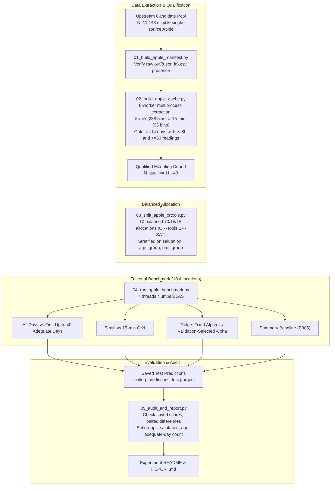

# Implementation Plan: Apple Watch Full Cohort Benchmark

## Goal Description

This plan extends the $N=1,000$ pilot to all qualified single-source Apple Watch (source 6) participants in the upstream eligible pool, with recorded binary salutation ($y \in \{0, 1\}$). It addresses the full-cohort benchmark in [Full Apple cohort scaling](../../learnings/future_experiments_backlog.md#full-apple-cohort-scaling); it does not implement a learning curve with fixed evaluation participants.

The agreed protocol prioritizes throughput: reuse training-fitted features across ridge penalties, use the existing validation split for selection, and perform focused checks without inner cross-validation.

1. **Target cohort**: All qualified participants from the upstream candidate pool of 11,143 single-source Apple users meeting the temporal adequacy gate ($\ge 8$ clock hours and $\ge 60$ readings on type 3000 HR; $\ge 14$ adequate days).
2. **Allocation structure**: 10 repeated holdouts (70% train / 15% val / 15% test) solved via OR-Tools CP-SAT, using the same split proportions and allocation count as the Garmin Tier 1c benchmark ($N=4,410$). Participants can recur across allocations; these are not independent test cohorts.
3. **Full factorial comparison**:
   - **Temporal resolution**: 5-minute (288 bins/day) vs 15-minute (96 bins/day).
   - **History budget**: All available adequate days vs first up to 40 chronological adequate days. Keep the same $\ge 14$-day cohort for both arms. The mean of approximately 265 days is a pilot observation; full-cohort history lengths remain to be measured.
   - **Ridge penalty**: Fixed $\alpha=1000.0$ vs alpha selected by validation AUROC from $\{1, 10, 100, 1000, 10000\}$, using the same standardized training features.
   - **Baseline**: Static summary baseline (305 features: daily distributions, contrasts, and observation frequencies).
4. **Saved outputs**: Participant test predictions, selected alphas, validation-selected thresholds, and subgroup summaries by recorded salutation, age group, and adequate-day count.

---

## Comparisons and selection

Each allocation evaluates six representations under two penalty rules: fixed $\alpha=1000$ and validation-selected alpha.

| Representation | All adequate days | First up to 40 adequate days |
|---|---|---|
| MultiRocket, 5-minute grid | Fixed and selected alpha | Fixed and selected alpha |
| MultiRocket, 15-minute grid | Fixed and selected alpha | Fixed and selected alpha |
| Summary baseline | Fixed and selected alpha | Fixed and selected alpha |

This gives $10 \times 6 \times 2 = 120$ reported conditions. Fit each of the five candidate alphas once per allocation and representation: 300 ridge fits in total. Reuse the $\alpha=1000$ fit for the fixed comparator and reuse each representation across all candidate alphas.

Participants with 14–39 adequate days contribute identical histories to both budget arms. Report their count and proportion. The history comparison measures the effect of capping available history at 40 adequate days in the qualified Apple cohort.

- **Training**: Fit clock-bin medians and MultiRocket biases on training days within the specified history budget and grid. Sample up to 4,096 training days for bias fitting. Fit feature imputation, variance filtering and scaling on training representations only.
- **Alpha selection**: Fit ridge for each candidate alpha on the same training features. Select the largest validation AUROC; break exact ties by choosing the larger alpha. Keep the selected fitted model without refitting on training plus validation. Do not run inner cross-validation.
- **Threshold selection**: For each fixed or selected model, maximize balanced accuracy on validation predictions. Use `y_score >= threshold` for class 1 and choose the largest threshold among tied optima. Save the threshold and apply it unchanged to all test participants and subgroups.
- **Test evaluation**: Use test predictions only for evaluation, after alpha and threshold selection. Validation metrics used for selection are development results.

## Execution environment

- Cache extraction uses 8 worker processes (`ProcessPoolExecutor`).
- Model execution configures 7 threads for Numba workqueue, OpenBLAS, and MKL.
- Run in the micromamba environment with read access to `out/`.

---

## Proposed Changes

We will place all experiment code in `experiments/apple_cohort_scaling/`.

### Component: Manifest and Cache Generation

#### [NEW] `experiments/apple_cohort_scaling/scripts/01_build_apple_manifest.py`
- Reads `experiments/artifacts_v2/cohort_manifest.parquet`.
- Filters single-source Apple: `epoch_src_6 == 1`, `epoch_multisource == False`, `cohort_category == 'eligible'`, `y.isin([0.0, 1.0])`.
- Confirms physical existence of `out/{user_id}.csv`.
- Saves `artifacts/apple_full_manifest.csv` with demographic covariates (`user_id`, `customer_id`, `salutation`, `y`, `age_group`, `bmi_group`, `csv_path`).

#### [NEW] `experiments/apple_cohort_scaling/scripts/02_build_apple_cache.py`
- High-throughput parallel extraction with 8 workers.
- Processes raw events: source 6, type 3000, $25 \le \text{HR} \le 230$, finite timestamps and offsets.
- Local timezone normalization: $\text{local\_ms} = \text{start} + \text{tz\_offset} \times 60\,000$.
- Day adequacy rule: $\ge 8$ clock hours AND $\ge 60$ readings.
- Synchronously extracts:
  - 5-minute curves (288 bins, float32)
  - 15-minute curves (96 bins, float32)
  - 8 daily statistics: mean, median, sd, vmin, vmax, n, cov_h, hours
- Filters participants with $\ge 14$ adequate days.
- Saves compressed `.npz` arrays to `artifacts/cache_5min/` and `artifacts/cache_15min/`.
- Writes qualification metadata to `artifacts/cache_5min/customers.csv`.

---

### Component: Balanced Allocations

#### [NEW] `experiments/apple_cohort_scaling/scripts/03_split_apple_ortools.py`
- Loads qualified cohort from `customers.csv`.
- Executes OR-Tools CP-SAT to generate **10 balanced 70/15/15 allocations** (`alloc_0` through `alloc_9`).
- Enforces exact proportional balance on salutation ($10 \rightarrow 0, 20 \rightarrow 1$), tight bounds on age-group and BMI-group marginals, and minimized joint stratification penalties.
- Saves `artifacts/apple_10_allocations.parquet`.

---

### Component: Factorial Modeling Benchmark

#### [NEW] `experiments/apple_cohort_scaling/scripts/04_run_apple_benchmark.py`
- Configures 7 CPU threads for Numba and linear algebra backends.
- Pre-loads participant caches into memory.
- For each of the 10 allocations:
  - Partitions participants into Train (~70%), Validation (~15%), and Test (~15%).
  - Evaluates both history budgets:
    - **All days**: Full available adequate history.
    - **First up to 40 adequate days**: Use the first $\min(n_{\text{adequate}}, 40)$ chronological adequate days per participant, including participants with fewer than 40 days.
  - Fits clock-bin median fill on training days.
  - Samples $\le 4,096$ training days to fit MultiRocket random convolutional kernels and bias quantiles.
  - Extracts 305 static summary features and MultiRocket pooled features.
  - Fits feature imputation, variance filtering and scaling once on training participants for each representation, then transforms validation and test features with those fitted parameters.
  - Fits `Ridge(alpha=alpha)` for each value in `[1.0, 10.0, 100.0, 1000.0, 10000.0]` on the same training features. Selects alpha by validation AUROC and retains the existing `alpha=1000.0` fit as the fixed comparator.
  - Selects one validation threshold per fixed or selected model using the rule above. Reuses fitted models without refitting on training plus validation.
  - Predicts continuous scores on test participants for both penalty rules.
- **Saved Outputs**:
  - `artifacts/apple_benchmark_metrics.csv`: Validation and test AUROCs, balanced accuracies, alphas, thresholds, and runtimes across all 120 conditions. Identify shared feature extraction and candidate-fitting time separately from evaluation time to avoid double-counting work.
  - `artifacts/alpha_selection.csv`: Validation AUROC for each candidate alpha, selected alpha, and validation-selected threshold for each reported model.
  - `artifacts/scaling_predictions_test.parquet`: Complete test predictions containing:
    `allocation`, `budget`, `resolution`, `representation`, `classifier`, `alpha`, `threshold`, `customer_id`, `y_true`, `y_score`. Use `classifier` to distinguish `ridge_fixed` from `ridge_selected`, including when both use alpha 1000.

---

### Component: Subgroup Audit & Synthesis Reporting

#### [NEW] `experiments/apple_cohort_scaling/scripts/05_audit_and_report.py`
- Independently recomputes test AUROCs directly from saved `scaling_predictions_test.parquet`.
- Evaluates paired differences:
  - MultiRocket gain over summary baseline: $\Delta_{\text{MR}} = \text{AUROC}_{\text{MR}} - \text{AUROC}_{\text{Summary}}$.
  - Resolution effect: $\Delta_{\text{res}} = \text{AUROC}_{5\text{m}} - \text{AUROC}_{15\text{m}}$.
  - History budget effect: $\Delta_{\text{budget}} = \text{AUROC}_{\text{All}} - \text{AUROC}_{\text{up to 40 days}}$.
  - Regularization selection effect: $\Delta_{\text{reg}} = \text{AUROC}_{\text{validation-selected alpha}} - \text{AUROC}_{\text{fixed alpha 1000}}$.
- Compute differences within matched allocations and conditions; summarize allocation variation as mean and SD, not as uncertainty from independent test cohorts.
- Subgroup analyses:
  - Overall test balanced accuracy and recall for each recorded-salutation class, using the saved validation threshold. Do not compute two-class balanced accuracy within a single salutation class.
  - Stratified AUROC by age group ($<30, 30-49, 50-64, 65+$), where both target classes are present.
  - Stratified AUROC by full-history adequate-day count terciles, where both target classes are present. Define cutpoints on training participants and apply the same cutpoints across history budgets. Adequate-day count measures available history, not wear density.
  - Report subgroup participant and class counts; mark AUROC unavailable for single-class groups. No additional model fits are required.
- Generates `experiments/apple_cohort_scaling/README.md` and detailed `REPORT.md`.

#### [MODIFY] `learnings/future_experiments_backlog.md`
- Updates `## Full Apple cohort scaling` to reflect the completed/running benchmark and cross-reference results.

---

## Focused verification

Use checks on the saved assignments, fitting provenance and predictions. Do not add nested cross-validation, exhaustive sensitivity runs or repeated model fitting for verification.

### Automated Checks
1. **Cohort Qualification**:
   - Verify qualification rate: compute $N_{\text{qualified}} / 11,143$.
   - Assert all qualified participants have $\ge 14$ adequate days.
   - Report the count and proportion with 14–39 adequate days; verify both budget arms use the same participants.
2. **Allocation Verification**:
   - Assert $\text{Train} \cap \text{Val} = \emptyset$, $\text{Train} \cap \text{Test} = \emptyset$, $\text{Val} \cap \text{Test} = \emptyset$ for all 10 allocations.
   - Assert marginal demographic deviations remain within 1 percentage point of population ratios.
3. **Reproducibility & Leak-Free Assertions**:
   - Assert MultiRocket biases and fill vectors derive strictly from training customer IDs.
   - Verify learned preprocessing uses training participants only; validation selects alpha and thresholds, and test participants influence neither fitting nor selection.
   - Assert zero missing values (`NaN`) enter Ridge estimators.
4. **Independent Score Reconstruction**:
   - Recompute test AUROC and balanced accuracy for each reported condition from saved scores and thresholds; compare with `apple_benchmark_metrics.csv` using an absolute tolerance of $10^{-10}$ for serialization and floating-point differences. Do not refit models.

### Manual Review Points
- Present the Apple pilot ($0.7554$) and Garmin Tier 1c ($0.9094$) as context. Differences in cohort, training sample size, recording process and history prevent attributing their performance differences to a single factor.
- Answer: How does capping history at 40 adequate days affect prediction within the qualified Apple cohort? This experiment cannot establish whether shorter histories explain the Apple–Garmin performance difference.
- Report the paired test AUROC difference between validation-selected alpha and fixed $\alpha=1000$, together with allocation variation and selected alphas.
