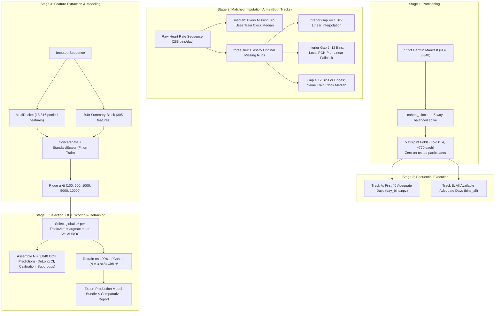

# Plan: Disjoint 5-Fold Cross-Validation, Three-Tiered Imputation, and Production Retraining on Strict Garmin Cohort

**Date**: 2026-10-15  
**Cohort**: Strict single-source Garmin cohort ($N = 3,848$, Tier 0)  
**Target**: Salutation ($10 \to 0/\text{Female}$, $20 \to 1/\text{Male}$)  
**Location**: [`experiments/k5_strict_garmin_interpolation/`](file:///Users/bulat/Documents/datenspende_IMPUTE_sex/experiments/k5_strict_garmin_interpolation/)

---

## 1. Executive Summary and Motivation

Previous Garmin evaluations used repeated random holdouts (e.g. 10 independent draws of 70% train / 15% validation / 15% test). Under that design, each participant had a $\approx 15\%$ probability of being in the test fold per allocation, leaving 751 participants ($\approx 19.5\%$) completely un-tested across all 10 allocations, while others were evaluated up to 6 times in overlapping test sets. Furthermore, missing heart rate bins were historically filled with static clock-bin diurnal medians or global medians without interpolating short gaps.

This experiment implements:
1. **$K=5$ Disjoint Stratified Partitioning**: Every participant belongs to exactly one validation slice ($1/K = 20\%$, $N \approx 770$). The remaining 4 folds ($(K-1)/K = 80\%$, $N \approx 3,078$) serve as the training/tuning slice. Zero participants are left un-tested ($N_{\text{untested}} = 0$).
2. **Matched Comparison of Two Imputation Arms**:
   - **`median`**: Fill every missing bin with its training-derived diurnal clock-bin median $\mu_{\text{clock}}(t)$ ($t \in \{0, \dots, 287\}$), with an overall training median fallback.
   - **`three_tier`**: Interior gaps of 1 missing bin use linear interpolation; interior gaps of 2–12 missing bins use local four-point PCHIP when original observed context is available, otherwise linear interpolation; longer gaps and day boundaries use the same clock-bin medians as `median`.
   - Both arms preserve observed values, masks, counts, participants, and selected days. Gap lengths count missing five-minute bins; the exact rules are specified in §3.2.
3. **Sequential Execution of Fixed-Budget and Full-History Tracks**:
   - **Part A (40 Days)**: Standardized fixed budget using the first 40 adequate days per participant ($153,920$ total days from [`day_bins.npz`](file:///Users/bulat/Documents/datenspende_IMPUTE_sex/experiments/temporal_garmin/cache/day_bins.npz)).
   - **Part B (All Days)**: Variable full history using all available adequate days per participant (mean $425.1$ days, range 80–979 days, $1,635,698$ total days from [`bins_all`](file:///Users/bulat/Documents/datenspende_IMPUTE_sex/experiments/temporal_garmin/cache/bins_all/)).
   - Run both imputation arms within each track using the same folds and matched random seeds.
4. **Single Global Optimal Hyperparameter Selection**:
   - Ridge regularization candidate grid: $\alpha \in \{100, 500, 1000, 5000, 10000\}$.
   - Selection rule: Single optimal parameter $\alpha^* = \arg\max_\alpha \frac{1}{5} \sum_{k=0}^4 \text{AUROC}_k(\alpha)$.
   - Apply this unchanged rule separately to each track/arm combination.
5. **Complete Out-of-Fold (OOF) Validation Assessment**:
   - Validation predictions under $\alpha^*$ across all 5 folds are assembled into a complete $N=3,848$ prediction vector.
   - Metric suite: AUROC with DeLong 95% CI and 2,000-draw stratified bootstrap 95% CI, AUPRC, Brier score, calibration curve (Platt slope and intercept), optimal classification threshold, and age/BMI subgroup audits.
6. **Full-Cohort Retraining ($K/K = 100\%$, $N=3,848$)**:
   - Retrain the entire imputation, MultiRocket transform, standard scaler, and Ridge model with locked $\alpha^*$ on all $3,848$ participants.
   - Save production model artifacts and deployment manifest separately for each track/arm combination.

---

## 2. Experimental Architecture



---

## 3. Protocol and Algorithmic Specifications

### 3.1 Stage 1: Disjoint 5-Fold Partitioning
* **Input manifest**: [`cohort_manifest_model_sources.parquet`](file:///Users/bulat/Documents/datenspende_IMPUTE_sex/experiments/artifacts_sq/cohort_manifest_model_sources.parquet) filtered to `source_id == 3` ($N = 3,848$).
* **Solver**: OR-Tools CP-SAT via [`cohort_allocator`](file:///Users/bulat/Documents/datenspende_IMPUTE_sex/cohort_allocator/README.md) (`seed = 20261015`).
* **Balancing constraints**:
  - Target `salutation` ($10 \to 0, 20 \to 1$): Hard proportional integer quotas per fold ($276\text{–}277$ class 0; $492\text{–}493$ class 1).
  - Covariates `age_band_5y` and `bmi_group`: Hierarchical joint-cell and marginal deviation penalties.
* **Output table**: `folds_5fold_disjoint.parquet` containing participant IDs, covariates, and fold labels `fold_0` through `fold_4`.
* **Invariant**: $\bigcup_{k=0}^4 \text{Fold}_k = \text{Cohort}$, $\text{Fold}_i \cap \text{Fold}_j = \emptyset$, and $\sum_{k=0}^4 I(i \in \text{Val}_k) = 1$ for all $i$.

---

### 3.2 Stage 2: Matched Median and Three-Tiered Imputation

For each participant-day sequence of 288 five-minute HR bin means $x \in \mathbb{R}^{288}$, use the original binary observation mask $m \in \{0, 1\}^{288}$. A bin is missing exactly when $m_t=0$; the cache stores zero sentinels at these positions. Never infer missingness from HR values or use imputed values as interpolation anchors. Both arms leave every originally observed value, mask, and count unchanged.

**Shared training median template.** For each track and fold, compute $\mu_{\text{clock}}(t)$ from originally observed HR bin means at clock bin $t$, using only training participants and the days selected for that track. Weight observed bin means equally, not by event count. If a clock bin has no training observations, use the median over all originally observed bins in that training set. Fail explicitly if that overall set is empty. Compute the template once per track/fold and use the identical template in both arms; interpolated values never enter median fitting.

**Arm `median`.** Replace every missing bin $t$ with $\mu_{\text{clock}}(t)$, regardless of run length or position. Here “median” means the clock-bin template above, not a participant/day median or one scalar for every clock bin.

**Arm `three_tier`.** Identify maximal contiguous runs of originally missing bins $r=(s,e,L)$, with inclusive indices and $L=e-s+1$. An interior run has $s>0$ and $e<287$, with originally observed bounding bins $s-1$ and $e+1$.

| Run | Exact rule |
|---|---|
| Interior, $L=1$ | Linear interpolation: $\hat{x}_s=(x_{s-1}+x_{e+1})/2$. |
| Interior, $2\le L\le12$, four-point context present | Require $s\ge2$, $e\le285$, and originally observed bins at $s-2,s-1,e+1,e+2$. Fit `scipy.interpolate.PchipInterpolator(..., extrapolate=False)` to exactly these four bin-centre coordinates and HR means; evaluate only $s,\ldots,e$. |
| Interior, $2\le L\le12$, four-point context absent | Linear interpolation across the entire run: $\hat{x}_{s+j-1}=x_{s-1}+\frac{j}{L+1}(x_{e+1}-x_{s-1})$, $j=1,\ldots,L$. |
| $L>12$, or any run touching a day boundary | Fill the entire run with the same $\mu_{\text{clock}}(t)$ used by `median`. |

Use only the specified adjacent original context; never seek more distant observations across another gap, partially interpolate a longer run, cross midnight, or extrapolate. A run of $L$ missing bins occupies $5L$ minutes of bins, while its bounding bin centres are $5(L+1)$ minutes apart: the 12-bin limit therefore spans 60 minutes of missing bins and 65 minutes between anchors. This is a fixed experiment convention. Both bounding observations are available for this retrospective participant-level task.

**Matched fitting and readout.** Keep folds, participant/day order, §3.3 feature definitions, class weighting, alpha grid, and preprocessing rules identical between arms. Within each track/fold, use the same training-day selection and random seeds for MultiRocket fitting, but refit its parameters and the downstream pipeline separately on each arm's inputs. Select $\alpha^*$ separately per track/arm using §3.4. Compare the fitted pipelines using paired `three_tier − median` AUROC differences, as specified in §3.5.

**Intervention exposure.** For each track, report the number and fraction of originally missing bins assigned to one-bin linear interpolation, PCHIP, medium-gap linear fallback, and clock medians. Include per-participant fractions and counts of participants/days with any interpolated bin. Mark fractions with zero denominators unavailable. These mask-derived counts are shared across folds and show how much input the two arms can change.

---

### 3.3 Stage 3: Feature Representation & Ridge Classification

1. **MultiRocket Sequence Transform**:
   - Reference implementation: Pinned MultiRocket (`ChangWeiTan/MultiRocket`, commit `3ccaa4f8`).
   - 1,250 random convolutional kernels $\times$ 4 pooling features (positive values proportion, mean of positive values, mean of positive indices, max) on primary sequence and first-difference sequence $\implies 18,816$ pooled features.
   - For each participant, day-level features are pooled into between-day mean and between-day sample standard deviation (ddof=1).
2. **Static B40 Summary Block**:
   - 305 features: daily summary statistics (mean, SD, min, max, percentiles) pooled into mean/SD across days, weekday vs. weekend contrast, and 288 bin observation frequencies.
3. **Normalization**:
   - Concatenated feature matrix (19,121 columns) is standardized via `StandardScaler(with_mean=True, with_std=True)` fitted strictly on training data.
4. **Ridge Classification**:
   - Regularization parameter $\alpha \in \{100, 500, 1000, 5000, 10000\}$.
   - Sample weights inverse to class frequencies: $w_y = \frac{N_{\text{train}}}{2 \cdot N_{\text{train}, y}}$.

---

### 3.4 Stage 4: Cross-Validation Execution & Optimal $\alpha^*$ Selection

For each track (40-day fixed budget; All-day full history), run both `median` and `three_tier` with matched folds and seeds as specified in §3.2:
1. **Loop over Folds $k \in \{0, 1, 2, 3, 4\}$**:
   - Split: $\text{Val}_k = \text{Fold}_k$ ($N \approx 770$), $\text{Train}_k = \bigcup_{j \ne k} \text{Fold}_j$ ($N \approx 3,078$).
   - Compute the shared $\mu_{\text{clock}}^{(k)}$ strictly on $\text{Train}_k$.
   - For each arm, apply its imputation rule to $\text{Train}_k$ and $\text{Val}_k$, then perform the following fitting and alpha sweep separately for that arm.
   - Fit MultiRocket kernel parameters and bias distribution strictly on $\text{Train}_k$.
   - Extract MR + B40 features; fit `StandardScaler` strictly on $\text{Train}_k$.
   - For each $\alpha \in \{100, 500, 1000, 5000, 10000\}$:
     - Fit Ridge model on $\text{Train}_k$.
     - Predict validation decision margin $f_k(x)$ on $\text{Val}_k$.
     - Calculate $\text{AUROC}_k(\alpha)$.
2. **Optimal Hyperparameter Identification**:
   $$\alpha^* = \arg\max_{\alpha} \overline{\text{AUROC}}(\alpha) = \arg\max_\alpha \left( \frac{1}{5} \sum_{k=0}^4 \text{AUROC}_k(\alpha) \right)$$
   Report validation AUROC curves across all $\alpha$ to document parameter sensitivity and flatness.

---

### 3.5 Stage 5: Out-of-Fold (OOF) Final Validation Assessment

For each track/arm, with its $\alpha^*$ selected, assemble the complete out-of-fold validation vector across all 5 folds ($N = 3,848$):
1. **Population-Level Discrimination**:
   - Overall OOF AUROC.
   - **DeLong 95% Confidence Interval**: Asymptotic variance accounting for ranking covariance.
   - **Stratified Bootstrap 95% Confidence Interval**: 2,000 stratified participant-level resamples.
   - Average Precision / AUPRC.
2. **Calibration & Probability Mapping**:
   - Fit Platt logistic recalibration on OOF decision margins:
     $$\hat{p}_i = \frac{1}{1 + \exp(- (a f(x_i) + b))}$$
   - Brier score.
   - Calibration intercept (calibration-in-the-large) and calibration slope.
3. **Decision Threshold & Operating Metrics**:
   - Optimal threshold $\tau^*$ maximizing balanced accuracy on OOF probabilities.
   - Sensitivity, Specificity, Accuracy, Balanced Accuracy, Positive Predictive Value (PPV), and Negative Predictive Value (NPV).
4. **Fold Stability Metrics**:
   - Mean and sample standard deviation ($\text{mean} \pm \text{SD}$) across the 5 validation slices.
5. **Subgroup Performance Audits**:
   - Performance stratified across Age Groups: Young Adults (18–39), Middle Age (40–59), Older Adults (60+).
   - Performance stratified across BMI Categories: Normal ($<25$), Overweight ($25\text{--}30$), Obese ($\ge 30$).
6. **Paired Imputation Comparison**:
   - Within each track, report each arm's selected $\alpha^*$, per-fold AUROC, and pooled OOF AUROC.
   - Report `three_tier − median` AUROC differences for each matched fold, their mean/sample SD, and the difference in pooled OOF AUROC. Use each arm's own selected $\alpha^*$; this compares the fitted imputation pipelines, including their tuning.
   - Use identical participant resamples for both arms in the existing 2,000-draw stratified bootstrap; report the paired OOF AUROC-difference interval alongside the arm-specific intervals.
   - Include the §3.2 intervention-exposure audit for each track.

---

### 3.6 Stage 6: Full-Cohort Retraining ($K/K = 100\%$, $N = 3,848$)

For each track/arm, with its $\alpha^*$ locked:
1. Fit clock-bin median imputation template on all $3,848$ participants.
2. Impute all days selected for that track using the arm's imputation rule; share the full-cohort median template between arms within a track.
3. Fit MultiRocket kernel transform and standard scaler on all $3,848$ participants.
4. Fit final Ridge model with $\alpha^*$ on all $3,848$ participants.
5. Save deployable artifact bundle:
   - Clock-bin imputation array (288 floats).
   - Arm identifier, exact gap/context rules, and overall training median fallback.
   - MultiRocket base and diff kernel structures.
   - B40 summary extractor and fitted `StandardScaler`.
   - Ridge model coefficients and intercept.
   - Platt calibration parameters $(a, b)$ and decision threshold $\tau^*$.

---

## 4. Directory Structure and Deliverables

All outputs will be saved in:
[`experiments/k5_strict_garmin_interpolation/`](file:///Users/bulat/Documents/datenspende_IMPUTE_sex/experiments/k5_strict_garmin_interpolation/)

```
experiments/k5_strict_garmin_interpolation/
├── PLAN.md                               # This finalized plan document
├── run_k5_experiment.py                  # Standalone executable pipeline script
├── folds_5fold_disjoint.parquet          # 5-fold partition manifest (CP-SAT)
├── REPORT.md                             # Comprehensive results and comparison report
├── track_40days/                         # Contents below repeated in track_alldays/
│   ├── imputation_exposure.json          # Gap rules applied to original masks
│   ├── imputation_comparison.csv         # Paired fold/OOF AUROC deltas and OOF bootstrap CI
│   ├── median/
│   │   ├── alpha_grid_results.csv        # 5-fold validation AUROC across alpha candidates
│   │   ├── oof_predictions.csv           # Complete N=3,848 OOF predictions under this arm's alpha
│   │   ├── metrics_summary.json          # DeLong CI, bootstrap CI, Brier, calibration, subgroups
│   │   └── production_bundle.joblib      # This arm retrained on 100% of cohort
│   └── three_tier/                       # Same four files as median/
├── track_alldays/                        # Same structure as track_40days/
└── reproducibility.json                  # Git commit, Python/package versions, data hashes, timing
```

---

## 5. Verification Guardrails and Invariants

1. **Partition Integrity**: Assert $\sum_{k=0}^4 I(i \in \text{Val}_k) == 1$ for all $3,848$ participants. Zero missing, zero duplicated.
2. **Strict Data Leakage Prevention**:
   - In cross-validation folds, `.fit()` on clock medians, MultiRocket kernels, scalers, and Ridge models MUST only be called on `Train_k`.
   - `Val_k` arrays must only pass through `.transform()` or `.predict()`.
3. **Imputation Array Invariants**:
   - Assert zero `NaN` or `inf` values in imputed heart rate arrays prior to feature extraction.
   - Assert bounded physiological range: $25 \le \text{HR} \le 230\text{ bpm}$.
   - Assert exact preservation of observed HR, original masks/counts, and participant/day alignment in both arms. Assert identical folds, median templates, fit-day selections, and seed conventions between arms within each track.
   - Check fixtures with interior gaps of 1, 2, 12, and 13 bins, both day boundaries, absent outer context, a turning point, and an empty training clock bin. Verify exact linear fallback, PCHIP values within the bounding HR values (numerical tolerance $10^{-5}$ bpm), and median filling for every ineligible run. Verify that `median` equals the shared template at every missing position.
   - Assert that the four exposure categories partition all originally missing bins. Assert that the arms agree everywhere outside interpolation-eligible positions; equality is allowed within eligible positions too.
4. **Execution Environment**:
   - Run via `/Users/bulat/micromamba/envs/datenspende/bin/python`.
   - Parallelism: 8 threads for Numba/Torch/MKL.
   - Expected runtime: $\approx 3.5\text{ min}$ for Track A (40 days) + $\approx 5.5\text{ min}$ for Track B (All days) $\approx 9\text{ minutes}$ total.
