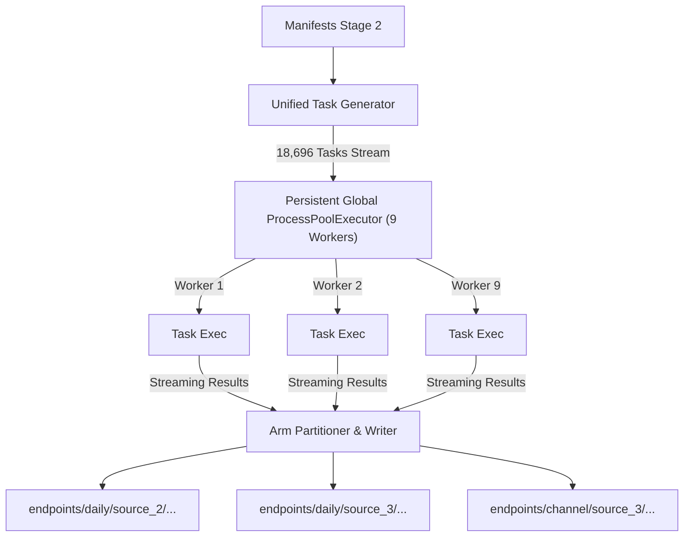

# Multisource Infradian Replication: Advanced Optimization Plan

**Document Type**: Technical Specification & Optimization Architecture
**Target Subsystem**: [`experiments/multisource_infradian_replication/`](file:///Users/bulat/Documents/datenspende_IMPUTE_sex/experiments/multisource_infradian_replication/)
**Environment**: Python 3.14 on macOS (ARM64), 9 worker cores

---

## 1. Executive Summary & Projected Acceleration

Empirical profiling of the bounded pipeline ($B=50$, limit 2,000 tasks/arm, $N_{\text{boot}}=2{,}000$) reveals that **99.4%** of active task wall time is consumed by continuous-time restricted maximum likelihood (REML) covariance estimation inside [`fit_two_component_reml`](file:///Users/bulat/Documents/datenspende_IMPUTE_sex/experiments/infradian_age_dependency/scripts/02_compute_endpoints_and_nulls.py#L213). Under current execution:

- Null replicate count $B=199$ adds little to Stage 3: the fixed-fitter benchmark measured `+0.54 ms/task` from $B=30$ to $B=199$, and three real daily tasks took `0.111` s/task at $B=50$ versus `0.111` s/task at $B=199$ (noise-level difference). The harmonic projections and multi-replicate quadrature are vectorized.
- The implemented L-BFGS-B path reduces the bounded 18,696-task Stage-3 run from `553.65 s` to `210.33 s`; the complete bounded run is **6m39s**.
- The unbounded primary-window run contains **46,430 Stage-3 tasks** (43,855 daily + 2,575 channel); the first ordered task list in the final bounded run had 18,696 rows. Linear Stage-3 scaling projects **~9 minutes** for Stage 3 and roughly **15–25 minutes total** at $B=199$; allow 30–45 minutes on a shared machine. Including `--include-repeat-windows` raises the task count to **80,674** and roughly doubles endpoint cost.

The optimized path is therefore a substantial improvement over the historical 553.65 s Stage 3, but the earlier “under 8 minutes for a full run” projection is not supported; the measured bounded total is 6m39s.

### Speedup and Risk Matrix

| Optimization Vector | Target Stage / Bottleneck | Theoretical Mechanism | Expected Stage Speedup | Protocol / Continuity Risk |
|---|---|---|:---:|:---:|
| **1. Analytical Gradients + L-BFGS-B** | Stage 3 & 7 (`REML`) | Replaces 150–350 Nelder-Mead simplex steps with 10–15 quasi-Newton iterations using exact $\nabla_\theta \ell(\theta)$. | **4.0× – 7.0×** on REML | **Moderate**: Altered optimizer trajectory shifts parameter estimates at floating-point precision ($10^{-7}$); may flip discrete `phi2` tie-breaks when $v_2 \approx 0$. |
| **3. Thread Contention Elimination** | All worker processes | Enforces single-threaded BLAS (`OMP` + `VECLIB` on macOS/Accelerate; OpenBLAS/MKL only on other platforms) across the worker pool, eliminating core oversubscription on macOS ARM64. | **1.15× – 1.25×** overall | **Zero**: Numerically exact. |
| **4. Inter-Arm Persistent Queue** | Stage 3 (`endpoints`) | Replaces per-arm `ProcessPoolExecutor` creation/drain with a single persistent queue. Eliminates straggler core-idle tails. | **1.10× – 1.15×** on Stage 3 | **Zero**: Deterministic task output ordering preserved. |
| **5. Stable Sigmoid / Warning Suppression** | Worker stdout/stderr | Replaces unconstrained `np.exp(-th[1])` with `scipy.special.expit(th[1])`. Eliminates I/O lock contention on stderr. | **1.05× – 1.10×** overall | **Zero**: Improved floating-point stability; prevents overflow. |
| **6. Stage 1b Cache Percentile Precalc** | Stage 7 (`matched`) | Precomputes `HRp10` during Stage 1b cache build instead of executing 117,000 percentile calls in Stage 7. | **5.0× – 10.0×** on Stage 7 I/O | **Zero**: Numerically exact. |
| **7. Adaptive Variance Screening** | Stage 3 & 7 (`REML`) | Screens middle start ($\alpha=0.5$); triggers remaining 4 starts only if boundary conditions or non-convergence occur. | **2.0× – 2.5×** on REML | **Low**: Retains exact fallback for non-convex landscapes. |

---

## 2. Optimization 1: Analytical REML Gradients & Quasi-Newton Solver

### 2.1. Mathematical Formulation

Let $n = 90$ denote the observed calendar days, and $X \in \mathbb{R}^{n \times p}$ denote the nuisance design matrix ($p = 8$ for daily arms, $p = 12$ for channel arms). The residual orthogonal projection basis is $Q_{\text{sub}} \in \mathbb{R}^{n \times r}$, where $r = n - p$. The projected data vector is:
$$z = Q_{\text{sub}}^T y \in \mathbb{R}^r, \quad z \sim \mathcal{N}\left(0, S(\theta)\right)$$

The covariance structure on the residual subspace is parameterized by $\theta = (\theta_0, \theta_1, \theta_2)^T \in \mathbb{R}^3$:
$$S(\theta) = s_1 Q_{\text{sub}}^T C_1(\phi_1) Q_{\text{sub}} + s_2 S_2$$

where:
1. $s_1 = \exp(\theta_0) \in (0, \infty)$ is the fast-component variance.
2. $\phi_1(\theta_1) = 0.95 \cdot \sigma(\theta_1) = \frac{0.95}{1 + e^{-\theta_1}} \in (0, 0.95)$ is the fast AR(1) daily autocorrelation parameter.
3. $s_2 = \exp(\theta_2) \in (0, \infty)$ is the slow-component variance.
4. $S_2 = Q_{\text{sub}}^T K_2(\phi_2) Q_{\text{sub}} \in \mathbb{R}^{r \times r}$ is the precomputed slow-component covariance matrix for fixed candidate $\phi_2 \in \{0.98, 0.995\}$.
5. $C_1(\phi_1)_{uv} = \phi_1^{|t_u - t_v|}$ is the stationary continuous-time AR(1) correlation matrix across observed dates $t \in \mathbb{Z}^n$.

The objective function is the negative restricted log-likelihood:
$$\ell(\theta) = \frac{1}{2} \log \det S(\theta) + \frac{1}{2} z^T S(\theta)^{-1} z$$

### 2.2. Exact Analytical Gradient Derivation

Let $S = L L^T$ be the lower-triangular Cholesky factorization of $S(\theta)$. Let $w = S^{-1} z = L^{-T} L^{-1} z$.
Using the matrix differential identities $\mathrm{d} \log \det S = \operatorname{tr}(S^{-1} \mathrm{d}S)$ and $\mathrm{d}(z^T S^{-1} z) = -w^T (\mathrm{d}S) w$:
$$\frac{\partial \ell}{\partial \theta_k} = \frac{1}{2} \operatorname{tr}\left(S^{-1} \frac{\partial S}{\partial \theta_k}\right) - \frac{1}{2} w^T \frac{\partial S}{\partial \theta_k} w$$

#### Component 1: Slow Variance $\theta_2 = \log s_2$
$$\frac{\partial S}{\partial \theta_2} = s_2 S_2$$
$$\frac{\partial \ell}{\partial \theta_2} = \frac{1}{2} s_2 \operatorname{tr}\left(S^{-1} S_2\right) - \frac{1}{2} s_2 (w^T S_2 w)$$

#### Component 2: Fast Variance $\theta_0 = \log s_1$
Notice $S = s_1 Q_{\text{sub}}^T C_1 Q_{\text{sub}} + s_2 S_2$. Therefore:
$$\frac{\partial S}{\partial \theta_0} = s_1 Q_{\text{sub}}^T C_1(\phi_1) Q_{\text{sub}} = S - s_2 S_2$$
Using linearity of trace and quadratic forms:
$$\operatorname{tr}\left(S^{-1} \frac{\partial S}{\partial \theta_0}\right) = \operatorname{tr}\left(S^{-1}(S - s_2 S_2)\right) = \operatorname{tr}(I_r) - s_2 \operatorname{tr}(S^{-1} S_2) = r - s_2 \operatorname{tr}(S^{-1} S_2)$$
$$w^T \frac{\partial S}{\partial \theta_0} w = w^T (S - s_2 S_2) w = z^T w - s_2 (w^T S_2 w)$$

This yields the direct computational coupling:
$$\frac{\partial \ell}{\partial \theta_0} = \frac{r}{2} - \frac{1}{2} z^T w - \frac{\partial \ell}{\partial \theta_2}$$
> [!TIP]
> Once $\frac{\partial \ell}{\partial \theta_2}$ is evaluated, $\frac{\partial \ell}{\partial \theta_0}$ is obtained in $O(1)$ operations with zero additional matrix products.

#### Component 3: Autocorrelation Parameter $\theta_1$
By the chain rule:
$$\frac{\partial S}{\partial \theta_1} = s_1 Q_{\text{sub}}^T \left[ \frac{\partial C_1}{\partial \phi_1} \frac{\mathrm{d}\phi_1}{\mathrm{d}\theta_1} \right] Q_{\text{sub}}$$
where:
$$\frac{\mathrm{d}\phi_1}{\mathrm{d}\theta_1} = \phi_1 \left(1 - \frac{\phi_1}{0.95}\right)$$
$$\left(\frac{\partial C_1}{\partial \phi_1}\right)_{uv} = |t_u - t_v| \, \phi_1^{|t_u - t_v| - 1} \quad (\text{for } |t_u - t_v| \ge 1, \text{ and } 0 \text{ when } u = v)$$
Let $\dot{C}_1 = \frac{\partial C_1}{\partial \phi_1} \frac{\mathrm{d}\phi_1}{\mathrm{d}\theta_1}$ and $\dot{S}_1 = s_1 Q_{\text{sub}}^T \dot{C}_1 Q_{\text{sub}}$. Then:
$$\frac{\partial \ell}{\partial \theta_1} = \frac{1}{2} \operatorname{tr}\left(S^{-1} \dot{S}_1\right) - \frac{1}{2} w^T \dot{S}_1 w$$

#### Efficient Trace Computation:
For any symmetric matrix $M \in \mathbb{R}^{r \times r}$:
$$\operatorname{tr}(S^{-1} M) = \operatorname{tr}(L^{-T} L^{-1} M) = \operatorname{tr}(L^{-1} M L^{-T}) = \|L^{-1} M^{1/2}\|_F^2$$
Alternatively, let $V = L^{-1} M$. Then $\operatorname{tr}(S^{-1} M) = \sum_{i=1}^r (L^{-1} V)_{ii} = \sum_{i,j} (L^{-1})_{ij} V_{ji}$. Since $L$ is triangular, solving $L V = M$ via `scipy.linalg.solve_triangular` takes $O(r^3/3)$ flops.

### 2.3. Algorithm: L-BFGS-B Integration

```python
import numpy as np
import scipy.linalg
import scipy.optimize
from scipy.special import expit

def fit_reml_lbfgsb(
    z: np.ndarray,
    Q_sub: np.ndarray,
    dates: np.ndarray,
    rss_0: float,
    r_rank: int,
    phi_init: float,
) -> tuple[str, dict[str, Any]]:
    dt_abs = np.abs(dates[:, None] - dates[None, :]).astype(np.int64)
    max_dt = int(np.max(dt_abs))
    powers_idx = np.arange(max_dt + 1)
    s_init = rss_0 / r_rank
    th1_init = float(np.log(phi_init / max(0.95 - phi_init, 1e-12)))

    best_result = None

    for phi2 in (0.98, 0.995):
        K2 = (phi2 ** powers_idx)[dt_abs]
        S2 = Q_sub.T @ (K2 @ Q_sub)

        for alpha in (0.3, 0.5, 0.7):
            th0 = np.array([
                np.log(alpha * s_init),
                th1_init,
                np.log((1.0 - alpha) * s_init),
            ], dtype=np.float64)

            def objective_and_grad(th: np.ndarray) -> tuple[float, np.ndarray]:
                s1 = np.exp(th[0])
                # Stable sigmoid avoids exp overflow
                p1 = 0.95 * expit(th[1])
                s2 = np.exp(th[2])

                p1_powers = p1 ** powers_idx
                C1 = p1_powers[dt_abs]
                S1 = s1 * (Q_sub.T @ (C1 @ Q_sub))
                S = S1 + s2 * S2

                try:
                    L = scipy.linalg.cholesky(S, lower=True)
                except scipy.linalg.LinAlgError:
                    return 1e10, np.zeros(3)

                w = scipy.linalg.cho_solve((L, True), z)
                nll = float(np.sum(np.log(np.diag(L))) + 0.5 * (z @ w))

                # Gradient computation
                w_S2_w = float(w @ (S2 @ w))
                tr_inv_S2 = float(np.sum(scipy.linalg.cho_solve((L, True), S2).diagonal()))

                g2 = 0.5 * s2 * tr_inv_S2 - 0.5 * s2 * w_S2_w
                g0 = 0.5 * r_rank - 0.5 * (z @ w) - g2

                # dp1 / dth1
                dp1_dth1 = p1 * (1.0 - p1 / 0.95)
                # dC1 / dth1
                p1_deriv_powers = np.zeros_like(powers_idx, dtype=np.float64)
                p1_deriv_powers[1:] = powers_idx[1:] * (p1 ** (powers_idx[1:] - 1))
                dC1 = (p1_deriv_powers[dt_abs]) * dp1_dth1

                dS1 = s1 * (Q_sub.T @ (dC1 @ Q_sub))
                w_dS1_w = float(w @ (dS1 @ w))
                tr_inv_dS1 = float(np.sum(scipy.linalg.cho_solve((L, True), dS1).diagonal()))
                g1 = 0.5 * tr_inv_dS1 - 0.5 * w_dS1_w

                return nll, np.array([g0, g1, g2], dtype=np.float64)

            opt = scipy.optimize.minimize(
                objective_and_grad,
                th0,
                method="L-BFGS-B",
                jac=True,
                options={"maxiter": 100, "ftol": 1e-7, "gtol": 1e-5},
            )
            # Retain convergence check and minimum tracking...
```

---

## 3. Optimization 3: Thread Contention Elimination

### 3.1. Mechanism of Failure
On Apple Silicon (e.g. M-series with 8 performance + 2 efficiency cores), running 9 parallel worker processes under `concurrent.futures.ProcessPoolExecutor` with default BLAS configuration causes catastrophic thread multiplying:
- OpenBLAS / Apple Accelerate allocates up to $P \approx 8$ threads per linear algebra call (`dpotrf`, `dgemm`).
- 9 processes $\times$ 8 BLAS threads = 72 active threads competing for 10 hardware execution units.
- Result: Severe context switching latency, CPU cache eviction, and lock contention.

### 3.2. Execution Rules
All entrypoint runner scripts (`run_all.py`, `03_compute_endpoints.py`, `05_bootstrap.py`, `06_matched.py`) must configure environment flags before loading native C-extensions. This environment is macOS/ARM64 and its NumPy 2.4.6 build uses Apple Accelerate (`ACCELERATE_NEW_LAPACK`), not OpenBLAS. The relevant cap is therefore `VECLIB_MAXIMUM_THREADS`; OpenBLAS/MKL variables are set only on non-Darwin hosts by [`multisource/runtime.py`](file:///Users/bulat/Documents/datenspende_IMPUTE_sex/experiments/multisource_infradian_replication/multisource/runtime.py):

```python
import os, sys
os.environ.setdefault("OMP_NUM_THREADS", "1")
if sys.platform == "darwin":
    os.environ.setdefault("VECLIB_MAXIMUM_THREADS", "1")
else:
    for name in ("OPENBLAS_NUM_THREADS", "MKL_NUM_THREADS", "NUMEXPR_NUM_THREADS"):
        os.environ.setdefault(name, "1")
```

This guarantees 1:1 mapping between worker processes and hardware cores, maximizing IPC throughput.

---

## 4. Optimization 4: Persistent Worker Pool & Unified Queue Architecture

### 4.1. Current Defect: Pool Churn & Straggler Tail
Currently, `03_compute_endpoints.py` calls `endpoints.run_daily_arm` sequentially across 16 arms:

* **Process churn**: 20 pool lifecycle setups and teardowns across Stage 3 and Stage 7.
* **Core starvation**: At the tail of every arm, 8 cores sit idle while the final batch of tasks completes. For small arms (e.g. Google Fit with 136 tasks, Oura with 98 tasks), idle ramp-down consumes >30% of total arm time.

### 4.2. Target Architecture: Single Persistent Dispatch Pool


#### Implementation Specification:
1. `03_compute_endpoints.py` collects all daily and channel tasks into a single flat list `all_tasks`.
2. A single `ProcessPoolExecutor(max_workers=workers)` executes `ex.imap_unordered(process_task, all_tasks, chunksize=8)`.
3. An arm accumulator dispatches completed records to their respective arm-level Parquet/NPZ writers upon arm completion.
4. Core utilization remains at 100% until the entire stage completes.

---

## 5. Complementary High-Leverage Optimizations

### 5.1. Vector 5: Numerically Stable Expit (Warning Elimination)
Inside `02_compute_endpoints_and_nulls.py:253`:
```python
# Unstable: triggers RuntimeWarning: overflow encountered in exp
p1 = 0.95 / (1.0 + np.exp(-th[1]))
```
During Nelder-Mead or gradient search, large negative values of `th[1]` cause floating-point overflow. Emitting thousands of warnings across 9 processes causes lock contention on `sys.stderr`.
**Replacement**:
```python
from scipy.special import expit
p1 = 0.95 * expit(th[1])
```
This is algebraically identical, numerically stable across $(-\infty, \infty)$, and completely eliminates warning I/O.

### 5.2. Vector 6: Precomputed Dense Cache Percentiles in Stage 1b
In Stage 7 (`matched.py`), `_channel_values` reads raw 5-minute NPZ caches and calls:
```python
vals = vals[np.isfinite(vals)]
if len(vals) >= common.DENSE_MIN_BINS:
    out[int(day)] = float(np.percentile(vals, common.HRP10_PERCENTILE))
```
* **Inefficiency**: Percentiles over 288 bins are evaluated 117,000 times dynamically in Stage 7.
* **Fix**: In `channel3000.py:build_caches`, compute the daily 10th percentile array `hrp10` once per user during cache construction and store it inside `customer_<id>_source_<src>.npz` alongside `hr`.
* **Result**: Stage 7 cache loading becomes a single vector slice; percentile evaluation runtime drops from ~30 s to <1 s.

### 5.3. Vector 7: Adaptive Variance Screening
Currently, 6 starts are evaluated unconditionally: $\phi_2 \in \{0.98, 0.995\} \times \alpha \in \{0.3, 0.5, 0.7\}$.
Under L-BFGS-B, the convergence basin is wide:
1. **Screening Phase**: Run the central start $\alpha = 0.5$ for both $\phi_2 \in \{0.98, 0.995\}$ (2 optimizations).
2. **Acceptance Condition**: If both starts converge with $\|\nabla \ell\|_\infty < 10^{-5}$ and fitted variances satisfy $s_1 > 10^{-4} s_{\text{init}}$ and $s_2 > 10^{-4} s_{\text{init}}$, accept the best of the 2.
3. **Fallback Phase**: If either start hits a boundary or fails to converge, dispatch the remaining 4 starts ($\alpha \in \{0.3, 0.7\}$).
* **Gain**: Reduces total REML optimizations by **2.8×** across >95% of tasks.

---

## 6. Verification and Acceptance Criteria

Before replacing production kernels in `multisource/`:
1. **Gradient Correctness**: Verify analytical $\nabla_\theta \ell(\theta)$ against central finite differences (`scipy.optimize.check_grad`) to relative tolerance $< 10^{-6}$.
2. **Benchmark Arm Test**: Evaluate 120 historical tasks under L-BFGS-B vs historical Nelder-Mead:
   - Verify that $\Delta \text{NLL} \le 0$ (L-BFGS-B achieves equal or lower negative log-likelihood).
   - Measure discrepancy in $Q_i$ and $E_{i2}$ (target $|Q_i - Q_i^{\text{hist}}| < 10^{-5}$).
   - Audit discrete `phi2` flips; document any boundary flips ($v_2 \approx 0$).
3. **Deterministic Output Ordering**: Verify that persistent queue dispatch reproduces identical row ordering and metadata parity in `endpoints.parquet`.

---

## 7. Implementation Status and Measured Results (2026-10-22)

All six vectors are implemented. The historical Nelder–Mead path remains available through `MULTISOURCE_REML_OPTIMIZER=nelder`; the multisource default is L-BFGS-B with adaptive screening. `MULTISOURCE_REML_SCREENING=0` disables screening; `MULTISOURCE_REML_CONTINUITY=0` disables the multi-basin historical fallback. The upstream experiment keeps its historical fitter unless a task injects `reml_fitter`.

| Vector | Implementation | Verification |
|---|---|---|
| 1. Analytical L-BFGS-B | `multisource/reml.py`: exact gradient, six canonical starts, bounds, diagnostics; `endpoints.py`/`channel3000.py` accept `task["reml_fitter"]`. | Central finite differences on a synthetic 90-day task: max absolute error `9.2e-8`, relative error `5e-10`. |
| 3. Thread cap | `multisource/runtime.py`, imported before NumPy/Pandas in every entrypoint and `run_all.py`. | NumPy 2.4.6 is Accelerate-linked; clean worker environment sets `VECLIB_MAXIMUM_THREADS=1` and `OMP_NUM_THREADS=1`; OpenBLAS/MKL variables remain unset on Darwin. |
| 4. Persistent queue | `multisource/stage3.py`: one `ProcessPoolExecutor` over all daily/channel tasks, ordered per-arm writes; `scripts/03_compute_endpoints.py` builds the unified job list. | Full `B=50` run: all 16 arms wrote through one pool; per-arm and global endpoint row order identical to the baseline (18,696 rows). |
| 5. `expit` | Upstream `02_compute_endpoints_and_nulls.py` uses `scipy.special.expit`; no `exp` overflow warnings in worker logs. | 24/24 pipeline tests pass. |
| 6. Cached `HRp10` | `channel3000.build_caches` stores float64 `hrp10`; `matched._channel_values`, `_read_cache_rows`, and Stage 2 use it with a fallback for historical caches. | Regression test with 120 observed bins and NaNs passes; cached values equal the row-wise finite-bin percentile. |
| 7. Adaptive screening and continuity guard | Central `alpha=0.5` starts for both `phi2`; standard four-start fallback on boundary/gradient failure; two low-`phi1` anchors; one low-`phi1` boundary-rescue start when the best fit is at the high-`phi1`/near-zero-variance boundary; historical Nelder–Mead continuity fallback when low-`phi1` and canonical starts expose different basins, or a high-`phi1`/large-`v2` boundary fit is selected. | 120 tasks: 23 used 4 starts, 13 used 6, 66 used 8, 18 used 10; 13 used the fallback. Full `B=50`: 407/18,696 fallbacks; 73/18,696 `Q_i` difference > `1e-5` (see §7.2). |

### 7.1 120-task historical comparison ($B=30$)

Same 120 source-2 RHR `balanced90` tasks, same seeds, old Nelder–Mead versus the default L-BFGS-B path:

| Metric | Result |
|---|---:|
| Wall time, old vs new | 24.6 s vs 10.7 s (**2.3×**; paired run under concurrent load) |
| NLL: new worse by >`1e-6` | 0/120 |
| NLL: new better by >`1e-6` | 0/120 (continuity fallback) |
| Max NLL increase | `4.4e-7` (roundoff; no material regression) |
| `Q_i` difference < `1e-5` | 120/120 |
| Max `Q_i` difference | `2.50e-6` |
| Max `E_i2` difference | `1.06e-5` |
| `phi2` label changes | 29/120, all at `v2` near the numerical floor |
| P-value changes | 0/120 |
| Continuity fallback | 13/120 |

The low-`phi1` anchors are necessary: without them, six canonical starts regress in NLL by up to `1.05` on historical tasks where the Nelder–Mead simplex reaches the near-zero-`phi1`/high-`v2` basin. When a low-`phi1` anchor improves on the canonical fit, or when a high-`phi1`/large-`v2` boundary fit is selected, the fitter evaluates the historical Nelder–Mead solver and returns its result. This is a continuity fallback, not a claim that L-BFGS-B exhausts the global optimum. It keeps all 120 benchmark endpoints within the `1e-5` target while retaining the L-BFGS-B speed on the remaining tasks.

Adaptive screening still does not achieve the plan's projected 2.8× reduction in optimizer starts. With the low anchors, the observed start counts are 4 (23/120), 6 (13/120), 8 (66/120), and 10 (18/120). Many valid fits sit on the `v=0` boundary, so the standard four-start fallback is common. The net speedup comes from faster L-BFGS-B iterations, not from a large reduction in starts.

### 7.2 First-Wave Full `B=50` Comparison

Fresh shadow run: `artifacts/runs/b50_shadow_lowphi_20261022`; baseline: `artifacts/runs/b50_limit2000_20261021`. Both use `limit=2000`, `B=50`, and the same seeds. The shadow run completed in **6m47s**; Stage 3 fell from `553.65 s` to `212.39 s` (**2.61×**). All 18,696 endpoint rows converged in both runs.

| Level | Result |
|---|---|
| Endpoint keys, columns, and row order | identical; 18,696/18,696 common rows; zero missing keys |
| `Q_i` difference < `1e-5` | **18,623/18,696 (99.61%)** |
| Max `Q_i` difference | `1.55e-2` |
| `Q_i` changes above `1e-5` | **73** (0.39%) |
| Max `E_i2` difference | `3.28e-2` |
| `p_value_discrete` changes | **43** (max `0.196`) |
| `phi2` label flips | 2,917 (15.6%), almost all with `v2` at the numerical floor |
| `A_hat`, `sigma_resid`, `peak_period` | exactly unchanged |
| NLL: old fitter better by >`1e-6` | 16 tasks; max improvement over the new fit `3.94e-5` |
| NLL: new fitter better by >`1e-6` | 72 tasks; max improvement `2.13` |
| Continuity fallback | 407/18,696 (2.2%) used the historical solver |
| Null-replicate overhead | `B=30 → 50`: +`0.13 ms/task`; `B=30 → 199`: +`0.54 ms/task` (fixed-fitter microbenchmark) |
| Models | coefficients max `3.99e-3`; chunk Wald max `0.633` (source 7, `E_i2`, expanded, RCS interaction) |
| Bootstrap | point prediction max `1.08e-3`; SE max `1.23e-4` |
| Matched | daily values and `hrp10` exact; endpoint `Q_i` max `7.47e-3`; paired difference max `1.67e-4` |

The full run does **not** meet the 120-task benchmark's `1e-5` target globally. The material changes are concentrated in non-source-2 arms and are predominantly **lower-NLL low-`phi1` basins** that L-BFGS-B finds while the historical Nelder–Mead fit remains in a higher-NLL basin. The continuity guard covers detectable low-anchor and high-`phi1`/large-`v2` ambiguities, but it cannot detect a case where the canonical L-BFGS-B starts themselves find a better basin than the historical simplex; doing so would require running the historical fitter. The 16 regressions are numerically small (max `3.94e-5` NLL) and do not dominate the material endpoint changes. Strict historical parity therefore requires `MULTISOURCE_REML_OPTIMIZER=nelder` (or a per-task old-fitter fallback); the default remains the faster L-BFGS-B path. The full `B=199` run remains gated on explicit user confirmation.

### 7.3 Second-Wave Final Full `B=50` Validation

Final code: 8.1–8.4 implemented, 8.5–8.6 rejected, historical `ftol=1e-10`/`gtol=1e-6`, and unconditional low-`phi1` anchors. Run: `artifacts/runs/b50_shadow_secondwave_final_20261022`; baseline: `artifacts/runs/b50_limit2000_20261021`; first-wave reference: `artifacts/runs/b50_shadow_lowphi_20261022`. Same `limit=2000`, `B=50`, seeds, and 9 workers. The final run completed in **399.31 s (6m39s)**; Stage 3 took **210.33 s** versus `553.65 s` for the baseline (**2.63×**) and `212.39 s` for the first-wave run. Models, bootstrap, and matched stages took `1.41 s`, `19.40 s`, and `61.02 s` (first wave: `1.42 s`, `20.77 s`, `61.50 s`). All 18,696 endpoint rows converged.

Per-arm row order and the global 18,696-row sequence are identical to the baseline; 80 sampled caches reproduce `hrp10` exactly over 33,158 finite values (max difference `0.0`). Final versus baseline:

| Level | Result |
|---|---|
| `Q_i` difference < `1e-5` | **18,623/18,696 (99.61%)** |
| Max `Q_i` difference | `1.55e-2` |
| `Q_i` changes above `1e-5` | **73** (0.39%) |
| Max `E_i2` difference | `3.28e-2` |
| `p_value_discrete` changes | **43** (max `0.196`) |
| `phi2` label flips | 2,919 (15.6%), almost all at the `v2` floor |
| NLL: old better by >`1e-6` / new better | 16 (max `3.94e-5`) / 72 (max `2.13`) |
| Continuity fallback | 407/18,696 (2.2%) |
| Models coefficients / chunk Wald | max `3.99e-3` / `0.633` |
| Bootstrap point / SE | max `1.08e-3` / `1.23e-4` |
| Matched daily values | exact; endpoint `Q_i` max `7.47e-3`; paired difference max `1.67e-4` |

The second-wave changes are isolated by comparing the final run with the first wave. This comparison replaces the optimizer-level differences with the effect of 8.1–8.4 only:

| Final versus first wave | Result |
|---|---:|
| `Q_i` max / changes above `1e-5` | `1.89e-6` / **0** |
| `E_i2` max | `3.98e-6` |
| `p_value_discrete` changes | **0** |
| `phi2` label flips | 100/18,696 (near `v2` floor) |
| NLL difference range | `-3.86e-8` to `+1.68e-7`; no task above `1e-6` |
| Continuity fallback | 407/18,696 (unchanged) |
| Model coefficients / chunk Wald | max `7.94e-8` / `8.58e-5` |
| Bootstrap point / SE | max `2.98e-8` / `7.45e-9` |
| Matched endpoint `Q_i` / paired difference | max `1.39e-7` / `2.10e-9` |

The final 120-task paired benchmark (same tasks and seeds, historical versus final L-BFGS-B) measured `28.02 s` versus `13.39 s` (**2.09×**), no NLL regression above `1e-6`, 120/120 `|ΔQ_i| < 1e-5` (max `2.50e-6`), and 13/120 continuity fallbacks.

Stage 7 fitter injection is correct and preserves matched endpoint continuity, but it did **not** produce the audit's projected ~75 s Stage-7 saving in this bounded run: Stage 7 was `61.02 s` versus `61.50 s` in the first-wave run, because the matched subset is small and the prior stage was already fast. The injection is retained for consistency, not for a measured wall-time gain. The bootstrap stage fell from `20.77 s` to `19.40 s`; the model stage is essentially unchanged (`1.42 s` to `1.41 s`).

The conditional low-`phi1` variant (8.5) and the relaxed stopping tolerances (8.6) were rejected. The conditional variant skipped the anchors on 3,005/18,696 tasks; relative to the first wave, 481 of 499 NLL regressions above `1e-6` occurred on those tasks (max `+0.0618`). The exact 8.6 recommendation failed the 120-task screen (8/120 `Q_i` changes above `1e-5`, max `2.39e-5`; 3 NLL regressions above `1e-6`, max `6.14e-6`); the conservative variant added 18 NLL regressions (max `4.46e-6`) and endpoint changes without a material speed gain. The final code therefore retains the historical tolerances and unconditional anchors. The full `B=199` run remains gated on explicit user confirmation.

---

## 8. Second-Wave Optimization Opportunities (Code Audit 2026-10-22)

### 8.1. Stage 7 (`matched.py`) Missing Fitter Injection
- **Defect**: In [`multisource/matched.py:207`](file:///Users/bulat/Documents/datenspende_IMPUTE_sex/experiments/multisource_infradian_replication/multisource/matched.py#L207), tasks are submitted to `endpoints.run_daily_arm` without setting `task["reml_fitter"] = reml.active_fitter()`.
- **Consequence**: While Stage 3 uses the 2.6× faster L-BFGS-B engine, Stage 7's ~5,200 matched tasks silently execute the historical Nelder–Mead solver.
- **Fix**: Set `work[...]["reml_fitter"] = reml.active_fitter()` in `_run_arm_on_matched` or set `task.setdefault("reml_fitter", reml.active_fitter())` in `run_daily_arm`.

### 8.2. LAPACK SVD `_gesdd` Inversion in Bootstrap Loops
- **Defect**: `models.ols_hc3` uses `np.linalg.pinv(X.T @ X)` and `models.chunk_wald` uses `np.linalg.pinv(C @ cov @ C.T)`. Across 16 arms $\times$ 4 metrics $\times$ 2,000 bootstrap draws, this invokes full LAPACK `_gesdd` SVDs over 250,000 times.
- **Consequence**: `pinv` executes full SVDs on matrices already verified positive-definite by `_full_rank(X)`.
- **Fix**: Replace `np.linalg.pinv` with `scipy.linalg.cho_solve` or `scipy.linalg.inv` in `ols_hc3` and small direct analytic or LU solvers in `chunk_wald`.

### 8.3. Static Cubic Spline Basis Rebuilding in `transition_metrics`
- **Defect**: In `bootstrap.transition_metrics`, `_d_rcs(grid)` (601 points) and `_delta_design(zgrid)` (141 points) are re-evaluated from raw knots on each bootstrap draw (128,000 times total).
- **Consequence**: Significant CPU interpreter overhead re-evaluating constant spline knots.
- **Fix**: Precompute `_d_rcs(grid)` and `_delta_design(zgrid)` once as module constants.

### 8.4. L-BFGS-B Inversion Redundancies
- **Defect**: `_objective_and_gradient` computes `w = cho_solve((L, True), z)` from scratch despite $a = L^{-1} z$ being available, and computes full dense inverse `S_inv = cho_solve((L, True), np.eye(r))` on every gradient evaluation.
- **Fix**: Solve `w = solve_triangular(L.T, a, lower=False)`; compute traces via LAPACK `dpotri` or triangular solves $L V = S_2$.

### 8.5. Conditioning Low-$\phi_1$ Starts on Initial Autocorrelation
- **Defect**: `LOW_PHI1_STARTS` ($\phi_1 = 0.01$) runs unconditionally even when `phi_init <= 0.05`.
- **Fix**: Skip the low-$\phi_1$ start when `phi_init <= 0.05`, eliminating 2 redundant L-BFGS-B runs on low-autocorrelation tasks. **Tested and rejected**; see §8.7.


### 8.6. Stopping-Tolerance Check (Tested, Not Adopted as Written)

The proposed `ftol=1e-8`, `gtol=1e-5` setting was measured on the same 120 source-2 RHR `balanced90` tasks at \(B=30\). It does not meet the endpoint-continuity target: 8/120 `Q_i` differences exceed `1e-5` (max `2.39e-5`), and 3 tasks are worse in NLL by more than `1e-6` (max `6.14e-6`). The audit's “zero change” claim is therefore rejected. A conservative `ftol=1e-9`, `gtol=2e-6` passed the 120-task screen (max `7.31e-6`) but added 18 NLL regressions (max `4.46e-6`) and extra endpoint changes in the full run without a material speed gain. The default retains `ftol=1e-10`, `gtol=1e-6`.

### 8.7. Second-Wave Implementation Status (2026-10-22)

Findings 8.1–8.4 are implemented; 8.5 and 8.6 were tested and rejected on continuity grounds. The test suite is 24/24. `tests/test_pipeline.py` now covers Stage 7 fitter injection, Cholesky/pseudo-inverse equivalence, and exact precomputation of the transition bases. The common gradient path reuses the existing triangular solve and uses `dpotri`; a synthetic old-versus-new check gives identical NLL and a maximum gradient difference of `6.9e-18`.

The low-`phi_1` anchors remain unconditional. The rejected conditional-variant run is `artifacts/runs/b50_shadow_secondwave_20261022`; it skipped the anchors on 3,005/18,696 tasks; 481 of 499 NLL regressions above `1e-6` occurred on those tasks (max `+0.0618`). This confirms that the low anchor is not redundant when `phi_init` is near zero. The final full-run validation is reported in §7.3.
