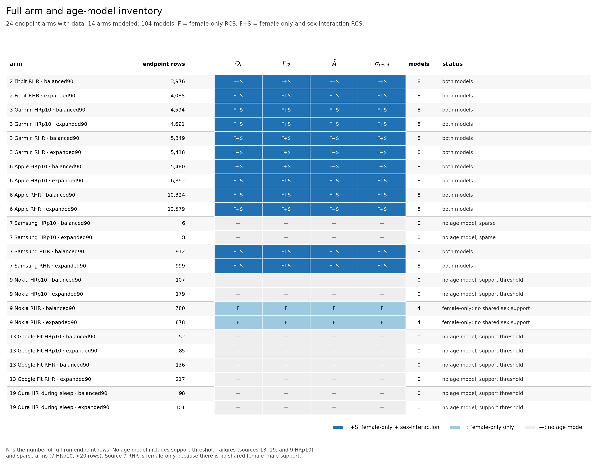
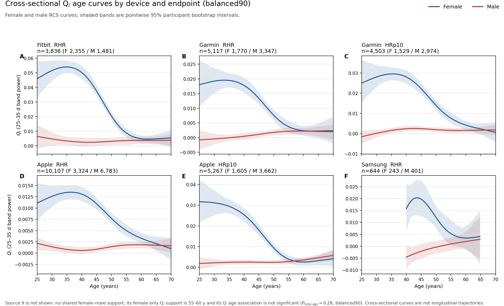
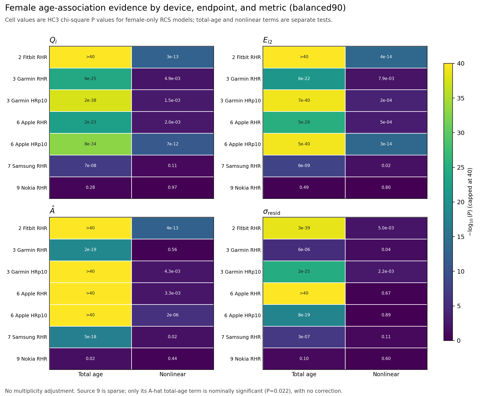
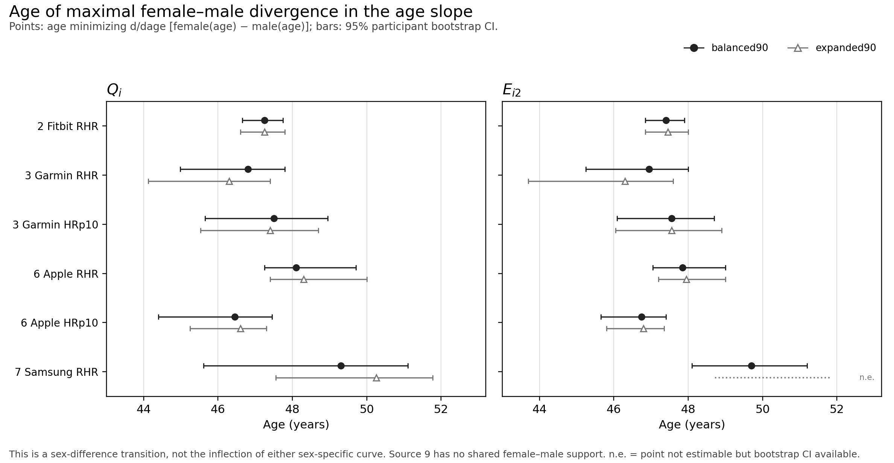
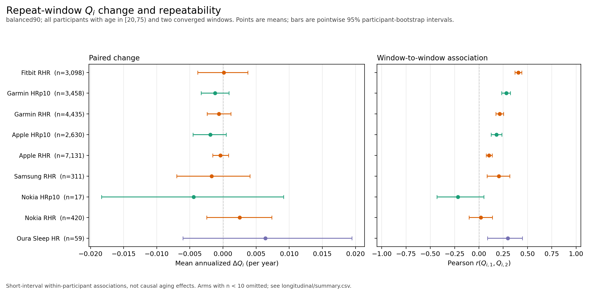

# Run figures

Figures 1–4 summarize the full primary-window run
`full_b199_boot1000_20261022` (`B=199`, `n_boot=1000`, sources
`2 3 6 7 9 13 19`, both protocols). Figure 5 summarizes the repeat-window
run `full_repeat_b199_boot1000_20261022` from the same sources. Unless stated,
they use `balanced90`. They are descriptive: age is cross-sectional, and the
repeat-window contrasts are short-interval within-participant associations,
not causal aging effects.

The primary run produced 65,449 endpoint rows, of which 65,443 converged. Six
rows are `rss0_degenerate`; see
`artifacts/runs/full_b199_boot1000_20261022/RUN_NOTES.md`. The repeat run
produced 110,736 endpoint rows (65,449 first-window and 45,287 second-window);
110,722 converged and 14 are `rss0_degenerate` (six first-window rows, the same
participants as the primary run, and eight second-window rows). See
`artifacts/runs/full_repeat_b199_boot1000_20261022/RUN_NOTES.md`.

## Arm and model inventory

All 24 endpoint arms with data. `F` = female-only RCS model; `F+S` = both
female-only and sex-interaction RCS models. The matrix shows model availability
for each metric; `endpoint rows` is the number of full-run endpoint rows.
Machine-readable table: [`arm_model_inventory.csv`](arm_model_inventory.csv).

Summary: 12 arms have both models (`96` models), source 9 RHR has female-only
models only (`8` models), and 10 arms have no age model. The latter comprise the
sparse Samsung HRp10 arms (6 and 8 rows) and the support-threshold failures for
Nokia HRp10, Google Fit RHR/HRp10, and Oura HR_during_sleep.

## Female and male `Q_i` age curves

`Q_i` is mean spectral power in the 25–35 d band. Curves are source- and
endpoint-specific RCS fits; shaded bands are pointwise 95% participant
bootstrap intervals. Source 9 is omitted because the sex-interaction model has
no shared female–male support; its female-only `Q_i` support is 55–60 y and its
total-age term is not significant (`P=0.28`).

## Female age-association tests

HC3 chi-square P values for the female-only RCS model: total-age and nonlinear
terms separately, for `Q_i`, `E_i2`, `A_hat`, and `sigma_resid`. Color is
`-log10(P)` capped at 40; printed values are untransformed. No multiplicity
adjustment. Source 9 is sparse; only its `A_hat` total-age term is nominally
significant (`P=0.022`).

## Age of female−male slope divergence

Points show the age minimizing `d/dage [female(age) - male(age)]`, i.e. where
the female−male slope difference is most negative. Bars are 95% participant
bootstrap intervals. This is a sex-difference transition, not the inflection
point of either sex-specific curve. `balanced90` and `expanded90` are shown
separately. Source 9 has no shared female–male support. `n.e.` means the point
was not estimable but a bootstrap interval was available (source 7, `E_i2`,
`expanded90`).

## Repeat-window change and repeatability

`balanced90`; participants with first-window age in `[20,75)`, two converged
windows, and arm `n ≥ 10`. Left: mean annualized `ΔQ_i`; right: Pearson
`r(Q_i1, Q_i2)`. Bars are pointwise 95% participant-bootstrap
intervals, stratified by five-year age band and sex. The full repeat-window
run contributed **45,279 paired participant-arm observations** from **16,571
unique source-participants** in **20 arms** with at least three pairs (16,350
unique source-participants contribute at least one arm to the `[20,75)`
summary stratum). Machine-readable tables:
[`longitudinal_headline.csv`](longitudinal_headline.csv),
[`longitudinal_availability.csv`](longitudinal_availability.csv), and
[`longitudinal_validation.json`](longitudinal_validation.json). The validation
file records exact first-window reproduction (all six metrics, 0 maximum
difference; 0 selected-date hash mismatches; 0 duplicate keys) and paired
counts.

Mean paired change is close to zero for every dense arm, with intervals that
mostly include zero; the largest dense-arm point estimate is Apple HRp10 at
-9.8e-4 (95% CI -2.3e-3 to 2.0e-4). Window-to-window `Q_i` correlations are
positive but modest: Fitbit RHR `r=0.41` (95% CI 0.37–0.44), Garmin HRp10
`r=0.28` (0.23–0.32), Garmin RHR `r=0.21` (0.17–0.25), Apple HRp10 `r=0.18`
(0.12–0.24), Apple RHR `r=0.10` (0.07–0.14), Samsung RHR `r=0.21`
(0.08–0.32), and Nokia RHR `r=0.02` (-0.10–0.14). Sex-specific intervals
differ for Fitbit and Garmin HRp10; those are secondary strata, not evidence
of a causal sex effect.

The figure omits sparse arms with `n < 10` and the Google Fit `balanced90`
arms (0 and 1 pairs). Nokia HRp10 has only 17 pairs and a wide interval; its
point estimate should not be read as a stable source-level effect. Follow-up is
mostly exactly 180 days, but Apple RHR has a long right tail (mean 0.74 years;
1,719/7,268 `balanced90` pairs exceed 365 days, maximum 818 days). The
annualized rate is therefore an extrapolation and is shown beside the observed
change; do not interpret it as a one-year aging rate. Two-window availability
selects participants: the paired fraction ranges from 0.49 (Apple HRp10) to
0.84 (Garmin RHR) in dense arms, and the standardized first-window `Q_i`
difference is small for dense arms but large for sparse Nokia HRp10
(`SMD=-0.32`). These estimates do not replace the cross-sectional curves or
identify menopause timing.

## Interpretation limits

- These are cross-sectional age curves; they do not identify within-person
  aging or causal effects.
- `Q_i` is band-integrated spectral power and `E_i2` is peak excess. Neither
  estimates the prevalence of a 25–35 d rhythm; null rejection is a separate
  analysis.
- The 46–50 y cluster in the third figure is a derived sex-difference
  transition, not evidence for menopause timing or a causal adult transition.
- Device-source consistency is not independent replication; users may overlap
  across sources.
- Intervals are pointwise, `n_boot=1000`, and P values are unadjusted.
