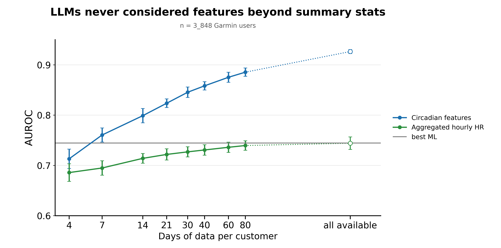

# Days-scaling experiments on the Garmin strict-coverage cohort

**Audit update, 2026-10-14.** Saved metric tables are retained. The all-days
endpoint reused allocation-0 training fill values and MultiRocket biases across
all allocations; later held-out users therefore entered transform fitting.
The result is exploratory, and its effect on AUROC is unknown. Extrapolations
below are descriptive rather than bounds on a performance ceiling. See the
[results audit](../../../reports/results_audit_2026-10-14.md).

## Headline

On the same 3,848 strict-coverage Garmin participants and the same ten
allocations used for v2, sampling *k* adequate days from each user's full
history (mean 425, min 80, p50 476, p90 539, max 979) instead of the first 40
raises single-arm MultiRocket test AUROC from **0.8361** (v2) to **0.8583**
(*k* = 40) to **0.8854** (*k* = 80) to **0.9264** at "all days". That is
**+0.070** over the best v2 representation (Combined MR ⊕ HYDRA, 0.8565) on
matched participants and folds, with frozen α = 1e3, no HYDRA, no
multichannel. MultiRocket is the only arm whose AUROC scales strongly with
budget: Profile24 gains +0.058 and summary RF +0.041 over the same range; MR
gains +0.213.

The budget curve is concave in *k*. On *k* ∈ [4, 80] it fits two functional
forms almost indistinguishably in-range:

- Log-linear: AUROC = *a* + *b* log₂(*k*); test *a* = 0.6450, *b* = 0.0395 per
  doubling, R² = 0.987, RMSE = 0.0064; val R² = 0.992, RMSE = 0.0047.
- LLN-style moment precision: AUROC = *L* − *C*/√*k*; test *L* = 0.9272,
  *C* = 0.4406, RMSE = 0.0060; val *L* = 0.9161, *C* = 0.4120, RMSE = 0.0070.

The fits describe the measured fixed-budget means, but neither supplies a
bound on the true ceiling. Averaging either fitted curve over users' own
pool sizes is only a heuristic: AUROC depends on positive–negative pairs,
so a fixed-budget AUROC curve does not determine AUROC under heterogeneous
budgets. No fixed-*k* point above 80 was measured, and the all-days endpoint
also changes transform fitting. The performance ceiling is unobserved.

Four endpoint qualifiers matter for any use of the 0.9264 number:

1. The endpoint is **one kernel draw** (comp seed 6) evaluated under ten
   fold-splits. Its SD (0.0055) measures variation across overlapping
   allocations conditional on that draw, not population uncertainty.
   Endpoint kernel-draw uncertainty was not measured.
2. α = 1e3 is frozen across the whole experiment; the
   α = 3e3 − α = 1e3 gap **flips sign** at the endpoint (−0.0085).
   The optimal penalty and any benefit on unseen users remain unknown.
3. "All days" is each user's own pool (80–979), not a fixed 425-day budget.
   Profile24 (+0.005) and summary RF (+0.001) have smaller gains over the
   same 80 → all transition; they do not bound recording-related
   information in the MR features.
4. Fill values and MR biases were fit on allocation-0 training users and
   reused across all ten allocations. For allocations 1–9, 380–413 of 573
   test users entered that transform-fitting set. Labels were not used in
   transform fitting; the effect on AUROC was not quantified.



**Figure.** Test AUROC vs days sampled per participant, full-history pool.
Markers at *k* ∈ {4, 7, 14, 21, 30, 40, 60, 80} with mean over 10 allocations;
error bars are 95% t-CI (df = 9). Open marker at *k* = 425 is the "all days"
endpoint: variable budget (80–979, mean 425), single kernel draw, CI is
fold-split-only. Dashed reference lines: fsplit Garmin (30 repeated 70/15/15
splits, same 3,848-user cohort) — default RF (A0, 534 features) 0.7435 and
feature-selected RF (A3_k50, top-50 by permutation importance) 0.7445. They
overlap (Δ = 0.001), reproducing the fsplit "feature selection buys nothing"
verdict on this cohort.

---

## 1. Design

Three experiments, all on the v2 cohort (3,848 R1b strict-coverage Garmin,
observed minimum 80 adequate ch3000 days) and v2's ten allocator allocations (70/15/15
train/val/test). MR kernels and all transforms are frozen at v2's protocol;
no HYDRA, no multichannel, no per-*k* kernel refit. Per-arm tests are paired
within allocation.

| | E1 — first-*k*, window | E2 — random-*k*, window | E3 — random-*k*, full pool + endpoint |
|---|---|---|---|
| *k* grid | {4, 7, 14, 21, 30} | {4, 7, 14, 21, 30, 40} | {4, 7, 14, 21, 30, 40, 60, 80} + endpoint (*k* = −1) |
| Days drawn from | user's first *k* adequate days (chronological) | first 40 adequate days, sampled uniformly without replacement | each user's entire adequate pool (mean 425), sampled uniformly without replacement |
| Days per user | exactly *k* | exactly *k* | exactly *k* (fixed-*k*) or 80–979 (endpoint) |
| Cohort selection | unchanged | unchanged | unchanged; 80 = min pool ⇒ no per-*k* cohort selection |
| Day permutation | n/a (chronological) | independent draws per *k* | one nested per-user random permutation per allocation (comp seed 5); *k*-points are prefixes |
| MR kernels | shared across *k* per alloc | shared across *k* per alloc | shared across *k* per alloc (fixed-*k*); single dedicated draw (comp seed 6) for endpoint |
| R allocations | 10 | 10 | 10 (fixed-*k*); 10 fold-splits evaluated at endpoint |
| Script | `day_scaling.py` | `day_scaling_random.py` | `day_scaling_all.py` |
| Wall | 620 s | ~816 s | 1,919 s (~145 s/alloc + 460 s endpoint); scan adds 183 s |
| Peak RSS | 6.5 GiB | ~7.0 GiB | 10.9 GiB — exceeds the v2 8 GiB gate |

**Within-experiment gates.**

- E2 *k* = 40 (identity draw = all 40 designated days) matches v2's saved
  AUROCs. `days_scaling_random_gate.csv` records `auroc_mine == auroc_v2`
  for all 30 (allocation × arm) cells, with
  `max_abs_dtest = max_abs_dval = 0.0`. The gate compares AUROC scalars;
  it does not establish identical participant scores.
- E3 reuses the v2 cohort and folds; `scan_users == users` and
  `dayall.user == repeat(users, days_per_user)` pass at load.
- Scan: 183 s, 0 errors, 0 zero-mask days, p50 observed bins/day = 283/288.

**Erratum (resolved; archived).** E1 and E2 v1 outputs (`*_v1mrbug.*`)
dropped B40Z from the B40Z ⊕ MRZ concatenation (n_cols = 18,816 vs v2's
19,121). Profile24 and Summary_RF numbers were correct throughout; the
corrected MR levels moved ≤ +0.002 AUROC vs buggy; the *k* = 40 replay gate
against v2 is exact. Buggy outputs are preserved and excluded from this
report.

---

## 2. Results

### 2.1 E3 full pool — test AUROC (mean ± SD over 10 allocations)

| *k* | MR α=1e3 | MR α=3e3 | Profile24 | Summary RF |
|---:|---:|---:|---:|---:|
| 4 | 0.7132 ± 0.0268 | 0.7348 ± 0.0240 | 0.6858 ± 0.0245 | 0.6692 ± 0.0245 |
| 7 | 0.7605 ± 0.0196 | 0.7799 ± 0.0171 | 0.6949 ± 0.0200 | 0.6755 ± 0.0234 |
| 14 | 0.7990 ± 0.0198 | 0.8159 ± 0.0182 | 0.7141 ± 0.0135 | 0.6860 ± 0.0201 |
| 21 | 0.8237 ± 0.0120 | 0.8391 ± 0.0130 | 0.7219 ± 0.0155 | 0.6961 ± 0.0205 |
| 30 | 0.8455 ± 0.0145 | 0.8573 ± 0.0146 | 0.7270 ± 0.0141 | 0.6984 ± 0.0227 |
| 40 | 0.8583 ± 0.0115 | 0.8684 ± 0.0128 | 0.7308 ± 0.0145 | 0.7023 ± 0.0200 |
| 60 | 0.8753 ± 0.0139 | 0.8814 ± 0.0131 | 0.7361 ± 0.0143 | 0.7089 ± 0.0225 |
| 80 | 0.8854 ± 0.0115 | 0.8894 ± 0.0116 | 0.7396 ± 0.0131 | 0.7098 ± 0.0179 |
| **all** | **0.9264 ± 0.0055** | 0.9179 ± 0.0072 | 0.7442 ± 0.0174 | 0.7106 ± 0.0222 |

### 2.2 E3 full pool — val AUROC

| *k* | MR α=1e3 | MR α=3e3 | Profile24 | Summary RF |
|---:|---:|---:|---:|---:|
| 4 | 0.7187 ± 0.0214 | 0.7389 ± 0.0198 | 0.6926 ± 0.0186 | 0.6693 ± 0.0179 |
| 7 | 0.7576 ± 0.0171 | 0.7765 ± 0.0200 | 0.7051 ± 0.0217 | 0.6754 ± 0.0195 |
| 14 | 0.7948 ± 0.0237 | 0.8120 ± 0.0241 | 0.7214 ± 0.0275 | 0.6902 ± 0.0261 |
| 21 | 0.8175 ± 0.0184 | 0.8317 ± 0.0199 | 0.7254 ± 0.0277 | 0.6968 ± 0.0243 |
| 30 | 0.8409 ± 0.0125 | 0.8518 ± 0.0143 | 0.7293 ± 0.0268 | 0.6996 ± 0.0217 |
| 40 | 0.8510 ± 0.0160 | 0.8609 ± 0.0182 | 0.7347 ± 0.0236 | 0.7052 ± 0.0216 |
| 60 | 0.8676 ± 0.0151 | 0.8742 ± 0.0183 | 0.7407 ± 0.0245 | 0.7071 ± 0.0172 |
| 80 | 0.8793 ± 0.0150 | 0.8835 ± 0.0181 | 0.7436 ± 0.0254 | 0.7107 ± 0.0173 |
| **all** | **0.9235 ± 0.0131** | 0.9165 ± 0.0151 | 0.7499 ± 0.0259 | 0.7238 ± 0.0191 |

### 2.3 E1 and E2 (window) — test and val means

| *k* | E1 MR-1e3 | E2 MR-1e3 | E1 MR-3e3 | E2 MR-3e3 | E1 P24 | E2 P24 | E1 RF | E2 RF |
|---:|---:|---:|---:|---:|---:|---:|---:|---:|
| test |  |  |  |  |  |  |  |  |
| 4 | 0.6932 | 0.7144 | 0.7168 | 0.7352 | 0.6930 | 0.6906 | 0.6713 | 0.6762 |
| 7 | 0.7322 | 0.7441 | 0.7535 | 0.7659 | 0.6942 | 0.7050 | 0.6681 | 0.6873 |
| 14 | 0.7750 | 0.7896 | 0.7946 | 0.8070 | 0.7123 | 0.7143 | 0.6944 | 0.6843 |
| 21 | 0.7979 | 0.8043 | 0.8151 | 0.8229 | 0.7210 | 0.7297 | 0.6967 | 0.6949 |
| 30 | 0.8117 | 0.8253 | 0.8281 | 0.8382 | 0.7292 | 0.7294 | 0.7026 | 0.7009 |
| 40 | — | 0.8361 | — | 0.8476 | — | 0.7370 | — | 0.7031 |
| val |  |  |  |  |  |  |  |  |
| 4 | 0.6834 | 0.7043 | 0.7050 | 0.7242 | 0.6852 | 0.6859 | 0.6719 | 0.6659 |
| 7 | 0.7188 | 0.7422 | 0.7400 | 0.7630 | 0.6936 | 0.6948 | 0.6656 | 0.6724 |
| 14 | 0.7770 | 0.7811 | 0.7953 | 0.7989 | 0.7069 | 0.7051 | 0.6860 | 0.6838 |
| 21 | 0.7962 | 0.8034 | 0.8118 | 0.8185 | 0.7123 | 0.7107 | 0.6852 | 0.6925 |
| 30 | 0.8138 | 0.8139 | 0.8261 | 0.8286 | 0.7171 | 0.7215 | 0.6924 | 0.6930 |
| 40 | — | 0.8284 | — | 0.8387 | — | 0.7248 | — | 0.6962 |

---

## 3. Findings

### 3.1 Budget curve (E3): diminishing observed gains, ceiling unobserved

The MultiRocket α=1e3 marginal gain per day is strongly concave in *k*:

| step | 4→7 | 7→14 | 14→21 | 21→30 | 30→40 | 40→60 | 60→80 | 80→all (+345 d) |
|---|---:|---:|---:|---:|---:|---:|---:|---:|
| ΔAUROC/day (test) | 0.01575 | 0.00550 | 0.00353 | 0.00242 | 0.00128 | 0.00085 | 0.00051 | 0.00012 |
| ΔAUROC/day (val)  | 0.01297 | 0.00531 | 0.00325 | 0.00259 | 0.00102 | 0.00083 | 0.00059 | 0.00013 |
| ΔAUROC/doubling (test) | 0.0585 | 0.0385 | 0.0422 | 0.0424 | 0.0308 | 0.0290 | 0.0245 | — |

Per-doubling gains decline ~58% from *k* = 4 to *k* = 80 (test). A pure
log-linear model would predict constant per-doubling gains; the observed
decline is the in-range signal that the curve is concave.

**Two two-parameter fits on the *k* ∈ [4, 80] segment** (test means):

| model | test | val | test RMSE | val RMSE |
|---|---|---|---:|---:|
| AUROC = *a* + *b* log₂*k* | *a* = 0.6450, *b* = 0.0395/doubling, R² = 0.987, SE(*b*) = 0.0019 | *a* = 0.6512, *b* = 0.0371/doubling, R² = 0.992, SE(*b*) = 0.0014 | 0.0064 | 0.0047 |
| AUROC = *L* − *C*/√*k* | *L* = 0.9272, *C* = 0.4406 | *L* = 0.9161, *C* = 0.4120 | 0.0060 | 0.0070 |

Both fits have similar descriptive error on the 8 fixed-*k* means. The
historical heuristic averaged each fitted curve over the 3,848 users'
own pool sizes. The 1/√*k* average was:

$$L \;-\; C\,\frac{1}{n}\sum_{u=1}^{n}\frac{1}{\sqrt{k_u}} \;=\; 0.9046 \text{ (test)}, \; 0.8949 \text{ (val)};$$

the log-linear average was:

$$a \;+\; b\,\frac{1}{n}\sum_{u=1}^{n}\log_2 k_u \;=\; 0.9860 \text{ (test)}, \; 0.9719 \text{ (val)}.$$

The observed endpoint (0.9264 test, 0.9235 val) lies between these
heuristics. This does not validate either endpoint prediction: AUROC is
a pairwise ranking functional, not an average of participant-specific
AUROCs. Variable budgets, a different kernel draw and cross-split
transform exposure also prevent interpreting that comparison as the
continuation of a controlled fixed-budget curve.

The 1/√*k* residuals at *k* = 60 and 80 are positive (test +0.0049,
+0.0074; val +0.0047, +0.0093); log-linear residuals there are negative
(test −0.0031, −0.0093; val −0.0031, −0.0068). These describe local fit
error, not bounds on the true curve or its ceiling. No fixed-*k*
measurement above 80 was taken.

For Profile24 and summary RF the per-day marginals are far smaller and the
total gain from *k* = 4 to "all days" is +0.058 (P24: 0.6858 → 0.7442) and
+0.041 (RF: 0.6692 → 0.7106) — about a quarter to a fifth of the
MultiRocket gain in absolute terms. Similar endpoint performance to the
fsplit references (§3.7) does not establish a ceiling for either model.

### 3.2 Pool effect at matched *k* (E3 − E2, paired, test)

Days drawn from the full adequate history vs the first-40-day window, same
allocation seeds, same folds. The arm-level deltas compare two sampling
and transform-fitting recipes at fixed participant day budgets:

| arm | *k* = 4 | *k* = 7 | *k* = 14 | *k* = 21 | *k* = 30 | *k* = 40 |
|---|---:|---:|---:|---:|---:|---:|
| MR α=1e3 (test) | −0.0011 [−0.026, +0.024] | **+0.0164** [+0.000, +0.033] | +0.0094 [−0.008, +0.026] | **+0.0194** [+0.008, +0.031] | **+0.0202** [+0.007, +0.033] | **+0.0222** [+0.011, +0.034] |
| MR α=1e3 (val)  | +0.0144 [−0.008, +0.037] | **+0.0154** [+0.001, +0.029] | +0.0136 [−0.003, +0.030] | **+0.0142** [+0.003, +0.025] | **+0.0269** [+0.013, +0.041] | **+0.0226** [+0.011, +0.034] |
| Profile24 (test) | −0.0047 [−0.013, +0.004] | **−0.0100** [−0.019, −0.001] | −0.0002 | −0.0078 [−0.017, +0.002] | −0.0024 | −0.0062 |
| Summary_RF (test) | −0.0069 | −0.0117 [−0.025, +0.002] | +0.0017 | +0.0012 | −0.0025 | −0.0008 |

MultiRocket is the only arm with a consistent positive pool effect at
*k* ≥ 7 (~+0.02 on test, +0.02 on val). At *k* = 4 the test pool effect
is essentially zero and the val pool effect is positive but the CI
straddles zero. Profile24 trends slightly negative at small *k*, while
Summary_RF changes little. These comparisons do not identify why the
representations respond differently.

**Protocol-difference caveat.** E3 and E2 also differ in the kernel-fit
window: E2 fits MR on `fit_days` chosen from the first-40-day window
(`K_MAX = 40`), E3 from a permuted 80-day window (`K_MAX = 80`). Both use
`comp_seed(r, COMP_DAY_SELECT)` so the kernel draws are different but
identically seeded. The +0.022 matched-*k* pool effect thus bundles two
things: (a) sampling-day diversity, and (b) a kernel fit on a larger and
more varied day set. Their separate contributions are not identified.
The fill-fitting windows differ as well.

### 3.3 Position effect within the window (E2 − E1, paired)

E1 (chronological first-*k*) vs E2 (uniform random *k* from the first-40
window). **The fitted transforms are not held identical:** E1 fits fill
values and MR biases using its first-30-day window, whereas E2 uses the
first-40-day window. Identical seed component IDs do not make fits on
these different inputs identical. E2 − E1 therefore combines day selection
with transform-fitting differences; it is not an isolated position effect.

| *k* | MR α=1e3 test | MR α=1e3 val |
|---:|---:|---:|
| 4 | **+0.0212** [+0.005, +0.037] | **+0.0208** [+0.001, +0.041] |
| 7 | +0.0119 [−0.002, +0.026] | **+0.0234** [+0.003, +0.044] |
| 14 | +0.0145 [+0.000, +0.029] | +0.0041 [−0.011, +0.020] |
| 21 | +0.0064 [−0.004, +0.017] | **+0.0072** [+0.001, +0.014] |
| 30 | +0.0136 [+0.000, +0.027] | +0.0001 [−0.011, +0.011] |

Effect is most clearly MR-specific at *k* = 4: both test and val deltas are
significant for MR (+0.021 each), while P24 and RF CIs straddle zero on both
metrics. At *k* = 7 the test deltas for P24 (+0.011 [+0.001, +0.021]) and
RF (+0.019 [+0.006, +0.033]) become significant while MR's (+0.012 [−0.002,
+0.026]) does not, so the position effect at *k* = 7 is not MR-specific.
At *k* ≥ 14 only MR trends positive on both metrics; the few P24/RF
marginal cells (P24 *k* = 21 test +0.009 [+0.000, +0.017]; RF *k* = 21 val
+0.007 [+0.001, +0.014]) are close to the significance threshold and not
robust across *k*.

Averaged across *k* ∈ {4, …, 30}, MR test deltas sum to +0.0676 (mean
+0.0135), P24 to +0.0192 (mean +0.0038), RF to +0.0104 (mean +0.0021).
So at matched *k* within a fixed 40-day window, drawing uniformly random
days beats drawing the first chronologically by ~+0.01–+0.02 for the
transform and by ~+0.003 on average for the cheap arms — present in the
same direction everywhere but ~3–6× larger for MR.

### 3.4 α × budget: the ranking of two tested penalties flips

α = 3e3 minus α = 1e3 (E3, paired):

| *k* | 4 | 7 | 14 | 21 | 30 | 40 | 60 | 80 | all |
|---|---:|---:|---:|---:|---:|---:|---:|---:|---:|
| test | +0.0216 | +0.0194 | +0.0169 | +0.0154 | +0.0118 | +0.0101 | +0.0062 | +0.0040 | **−0.0085** |
| val  | +0.0202 | +0.0189 | +0.0173 | +0.0142 | +0.0109 | +0.0098 | +0.0066 | +0.0042 | **−0.0071** |

The sign of the 3e3 − 1e3 gap changes between *k* = 80 and the endpoint.
This establishes a reversal between the two tested penalties. It does not
locate the optimal α or show that further tuning would improve unseen-user
AUROC. A sampling-precision explanation is plausible, but days are not
known to be independent and the endpoint changes several protocol elements.

### 3.5 Representation gap widens monotonically with budget

MR α=1e3 − Profile24 (E3, test):

| *k* | 4 | 7 | 14 | 21 | 30 | 40 | 60 | 80 | all |
|---|---:|---:|---:|---:|---:|---:|---:|---:|---:|
| Δ | +0.0274 | +0.0656 | +0.0849 | +0.1018 | +0.1185 | +0.1275 | +0.1392 | +0.1458 | **+0.1822** |

Grows monotonically from +0.027 at *k* = 4 to +0.182 at the endpoint
(~6.7×) in the saved allocation means. Greater stability of pooled MR
features is one possible explanation; this analysis did not measure the
effective number of independent days or identify the mechanism.

### 3.6 Endpoint design and confound controls

The endpoint (k = −1) differs from the fixed-*k* points in several ways:

1. **Variable budget.** Each user's own pool (80–979, mean 425; p10 225,
   p50 476, p90 539) replaces a fixed *k*. Engagement, recording patterns
   and feature-estimation precision can all vary with pool size.
2. **Single transform fit with cross-split exposure.** One dedicated
   kernel draw (comp seed 6) and allocation-0 fill are reused under all
   ten fold-splits. Endpoint SD = 0.0055 describes these overlapping
   allocations conditional on that transform. Neither kernel-draw
   uncertainty nor the effect of held-out-user exposure was measured.
3. **Static-feature comparisons.** The 80 → all-days deltas, on arms
   that share the same B40 statics, are:

   | arm | k=80 → all (test) | k=80 → all (val) |
   |---|---:|---:|
   | MultiRocket α=1e3 | **+0.0410** [+0.033, +0.049] | +0.0442 [+0.037, +0.052] |
   | MultiRocket α=3e3 | +0.0285 [+0.021, +0.036] | +0.0329 [+0.026, +0.039] |
   | Profile24 | +0.0046 [−0.001, +0.011] | +0.0062 [+0.001, +0.011] |
   | Summary_RF | +0.0008 [−0.011, +0.012] | +0.0132 [+0.002, +0.024] |

   Smaller Profile24/RF gains show that these particular models respond
   less to the endpoint recipe. They do not bound recording-related
   information in MR, transform-fitting exposure, or interactions between
   budget and representation.

The endpoint increase can combine day budget, kernel fitting, heterogeneous
feature precision and recording-related information. These contributions
are not separately identified. The heuristic curve averages in §3.1 do
not provide a counterfactual endpoint against which to decompose the gain.

### 3.7 References on the same cohort

**fsplit Garmin** (30 repeated 70/15/15 splits, source 3, same 3,848 users):

- Default RF (A0, 534 features): test AUROC **0.7435 ± 0.0172**.
- Feature-selected RF (A3_k50, top-50 by permutation importance on val):
  test AUROC **0.7445 ± 0.0165**.

Δ = 0.001 — fsplit's own conclusion that feature selection buys nothing on
this cohort. Profile24 at the full-history endpoint (0.7442) sits between
these two references (gap ≤ 0.0007 from each), so hour-profile ridge
has a similar saved AUROC to these RF references, despite different
feature matrices and evaluation designs.

**v2 frozen ladder** (same cohort, first-40-day window, 10 allocations):

| arm | test AUROC | source |
|---|---:|---|
| Combined (MR ⊕ HYDRA) | 0.8565 ± 0.0146 | `temporal_metrics.csv` |
| HYDRA | 0.8442 ± 0.0113 | v2 |
| MultiRocket | 0.8361 ± 0.0149 | v2 (= E2 *k* = 40 anchor) |
| Summary linear | 0.7157 ± 0.0204 | v2 |
| Summary RF | 0.7031 ± 0.0192 | v2 (= E2 *k* = 40 anchor) |

E3 *k* = 40 already matches Combined v2 (0.8583 vs 0.8565); E3 endpoint
0.9264 single-arm beats the entire v2 ladder by **+0.070**.

---

## 4. What this does and doesn't show

**Observed on this cohort and allocations.** MultiRocket AUROC increases
with the measured fixed day budgets. Sampling from full histories and
fitting the transform on those windows produces higher mean AUROC than
the early-window recipe at most matched budgets. Profile24 and summary RF
show smaller gains. The all-days recipe reaches 0.9264, compared with
0.8854 at *k* = 80, but changes budget, kernel draw and fitting exposure.

**Not established.** A physiological mechanism, independent-day precision
law, performance ceiling, optimal penalty or population-level uncertainty.
The fitted log-linear and 1/√*k* curves are descriptive; neither bounds the
ceiling, and averaging them over users' pool sizes does not identify
heterogeneous-budget AUROC. No fixed-budget point above 80 was measured.

**Specific qualifiers.**

1. **Endpoint single kernel draw.** SD = 0.0055 across overlapping
   allocations conditional on that draw. Endpoint kernel-draw uncertainty
   was not measured.
2. **Budget heterogeneity.** The P24/RF comparisons do not eliminate or
   quantify recording-related information in MR features.
3. **α frozen.** The two tested penalties reverse ranking at the endpoint;
   tuning gains on new users are unknown.
4. **Cohort selection.** The existing strict-coverage cohort has an
   observed minimum of 80 adequate days and mean 425. This is not a new
   ≥80-day inclusion gate or evidence about shorter-history users.
5. **RSS deviation.** E3 peak RSS = 10.9 GiB exceeds the v2 8 GiB gate;
   E1 and E2 stayed within it.
6. **Cross-split transform exposure.** Allocation-0 fill and MR biases
   were reused across all ten allocations. In allocations 1–9, 380–413
   of 573 test users entered transform fitting. This differs from v2's
   per-allocation training-only fill/bias fitting. Labels were excluded
   from transform fitting, but its AUROC effect is unknown.
7. **Repeated development.** Allocation-0 validation labels selected α;
   80–98 of those users occur in later test allocations. Participants and
   splits were reused across experiments. Reported intervals describe
   allocation variation conditional on this cohort and protocol, not
   independent external confirmation.

---

## 5. Methods

### 5.1 Cohort, folds, bins

Same as v2: 3,848 R1b strict-coverage Garmin participants
(`experiments/r1b_dateaware_garmin_2026-09-21/cache/dayall_table.parquet`),
an observed minimum of 80 adequate ch3000 days per participant. Per day, 288 × 5-min local-clock
bins of event-mean HR, source = 3, ch = 3000, NaN-tz rejection, HR ∈
[25, 230], `EXCLUDED_SOURCES` filtered. The same 10 allocator allocations
(70/15/15 train/val/test) used for v2 are reused; per-arm tests are paired
within allocation. Cohort distribution of adequate-day counts: min 80,
p10 225, mean 425, p50 476, p90 539, max 979 (n = 3,848).

### 5.2 MultiRocket (vendored)

84 fixed kernels: all C(9,3) = 84 weight patterns on the 9-point dilated
kernel, with effective weights −1 at six taps and +2 at three taps. Per kernel,
*b* = ⌊1250 / 84⌋ = 14 bias channels; biases are quantiles of the
convolved training output, numba-internal RNG (`_nb_seed` shim before each
`mr_fit` is mandatory for reproducibility — v2 REPORT §8 erratum).
At input length 288, the 14 log-spaced slots give 11 distinct integer
dilations {1, 2, 3, 5, 6, 9, 11, 15, 20, 27, 35}. Four feature types per (kernel, dilation, bias) channel: PPV
(proportion above bias), LSPV (positive-stretch statistic in the reference implementation), MPV (mean of
above-bias values), mean-activation index (mean index of above-bias
activations, −1 if PPV = 0).

Day-level features per transform:

$$84 \times 14 \times 4 \;=\; 4{,}704.$$

Two transforms — the level series *X* and the first difference *X*1 — each
fitted independently, so per-day F_d ∈ ℝ^9408.

### 5.3 User-level pooling

For each user with observed-day indicator *o*<sub>*d*</sub> ∈ {0, 1}:

$$\hat\mu_j \;=\; \frac{1}{\sum_d o_d}\sum_{d=1}^{k} o_d F_{d,j}, \qquad \hat\sigma_j^{\,2} \;=\; \frac{1}{\sum_d o_d - 1}\sum_{d=1}^{k} o_d \bigl(F_{d,j} - \hat\mu_j\bigr)^2.$$

The user-level MRZ block is [$\hat\mu$, $\hat\sigma$] ∈ ℝ^18,816. Profile24
is mean + ddof-1 SD over the 24 `hour_h{h}` columns of the same days
(48 cols). B40 (305 cols raw) is mean + SD of 8 daily ch3000 stats
(`d_ch3000_{mean, median, sd, vmin, vmax, n, cov_h, hours}`), per-bin
`mask_K[:, :k, :].mean(axis=1)` (288 mask observation frequencies), and
`weekday_mean − weekend_mean` of daily mean HR (NaN when the *k* sampled
days contain no weekend day; imputed by `hygiene_std`).

### 5.4 Hygiene per block

`SimpleImputer(strategy="median")` → `VarianceThreshold(0.0)` →
`StandardScaler`. All three fitted on train rows of the allocation, applied
unchanged to val/test. The MRZ block is constant-size 18,816 columns (0
columns dropped by VT in every run). The B40Z block is 305 columns raw;
VT drops per-bin mask_means columns whose train-fold variance is below the
threshold, so post-VT B40Z contributes 275–305 columns depending on
allocation and *k*. Total concatenation *n*_cols varies in
**19,091–19,121** across the (alloc, *k*) grid.

### 5.5 E3 fixed-*k* loop

For each of the 10 allocations:

1. **Nested permutation.** `perm_rng = default_rng(comp_seed(r, COMP_PERM))`.
   Per user, sample `argsort(rng.random(days_per_user[u]))[:80]` — a uniform
   random ordering of the user's adequate days truncated at 80.
2. **Prefix structure.** The fixed-*k* curve reuses these prefixes: every
   *k* ∈ {4, …, 80} is a prefix of the same per-user random order. **K-points
   within an allocation share kernel noise and permutation noise** — the
   budget axis is isolated on a fixed random day sequence.
3. **MR fit per allocation.** `fit_rng = default_rng(comp_seed(r, COMP_DAY_SELECT))`,
   `fit_days = stack([choice(80, 4, replace=False) for _ in range(n_tr)])`,
   `X_fit = hr_filled_K[tr[:, None], fit_days]` → `mr_fit(X_fit)` and
   `mr_fit(np.diff(X_fit, axis=1))`.
4. **Transform.** First 80 sampled days per user, chunked over 256 users:
   `X.reshape(sz × 80, 288) float64`, `X1 = diff(X, axis=1)`,
   `mr_transform(X, X1, params_base, params_diff, 4)`. Pool **prefixes**
   by $\hat\mu$ and $\hat\sigma$ into `pooled_mean[:, ki, :]`,
   `pooled_sd[:, ki, :]`.
5. **Statics per *k*.** Groupby mean/SD over
   `dayall.iloc[(starts[:, None] + perm[:, :k]).ravel()]`; mask block from
   `mask_K[:, :k, :].mean(axis=1)`.
6. **Fit four arms.** MR primary α=1e3, MR sens α=3e3, P24 α=1e3, RF G1
   @ 100 trees on train rows of the fold.

### 5.6 E3 endpoint (Phase B)

- **Single MR fit.** Comp seed 6, fit on 4 seeded days from alloc-0 train
  users' full pools (`efit_rng = default_rng(comp_seed(0, COMP_ENDPOINT))`,
  `efit_days = stack([choice(int(dpu[u]), 4, replace=False) for u in tr])`).
- **Per-user full-pool transform** (sequential; ~0.1 s/user), pool
  $\hat\mu$/$\hat\sigma$.
- **Full-pool statics.** Groupby over 1.64M dayall rows; mask_means looped
  over users from memmap.
- **Evaluate under all 10 fold-splits.** Hygiene + ridge + RF refit per
  split, no kernel refit.

### 5.7 E1 / E2 (window)

E2 mirrors E3 with `K_MAX = 40` and *k* ∈ {4, 7, 14, 21, 30, 40} over the
first-40 adequate-day window. E1 uses chronological first-*k* and fits fill
values/biases using the first 30 days. E2 includes the *k* = 40 AUROC
agreement gate against v2.

### 5.8 Component seeds

`comp_seed(r, c)` is the first uint32 from
`SeedSequence([20260921, 3, r, c]).generate_state(1, dtype=uint32)`.
Existing v2 component IDs reused (`COMP_DAY_SELECT` = 0 etc.); COMP_PERM
= 5 (nested per-user permutation, E3) and COMP_ENDPOINT = 6 (endpoint
kernels, E3 Phase B) are new.

### 5.9 Scan (`scan_bins_all.py`)

Re-reads the same 3,848 epoch files as v2 but bins **all 1.64M adequate
user/date pairs** (vs v2's 153,920 first-40-day pairs). 4 workers (v2 used
2). Outputs uncompressed `.npy` for downstream memmap: `hr_all.npy`
(1.64M, 288) float32, `mask_all.npy` (1.64M, 288) bool, `user_all.npy`,
`date_all.npy`, `days_per_user.npy`, `user_ids.npy`, `starts.npy`. `cnt` is
not stored (not a model input). Scan: 183 s, 0 errors, 0 zero-mask days,
p50 observed bins/day = 283/288.

---

## 6. Files

```
experiments/temporal_garmin/
├── day_scaling.py                       # E1 (first-k, window) — corrected
├── day_scaling_random.py                # E2 (random-k, window) — corrected, k=40 v2-replay gate
├── day_scaling_all.py                   # E3 (random-k, full pool) + endpoint
├── scan_bins_all.py                     # full-history 288-bin scan, 4 workers
├── plot_days_scaling.py                 # figure + aggregates
├── results/
│   ├── days_scaling_metrics.csv         # E1
│   ├── days_scaling_random_metrics.csv  # E2
│   ├── days_scaling_random_gate.csv     # E2 k=40 v2-replay gate (Δ = 0.0)
│   ├── days_scaling_all_metrics.csv     # E3 (k = −1 ⇒ endpoint)
│   ├── days_scaling.md                  # E1 standalone report
│   ├── days_scaling_random.md           # E2 standalone report
│   ├── days_scaling_all.md              # E3 standalone report
│   ├── days_scaling_curves.png          # figure (this report)
│   ├── days_scaling_curves.pdf          # figure (this report)
│   ├── DAYS_SCALING_REPORT.md           # this report
│   ├── temporal_metrics.csv             # v2 frozen ladder (anchor)
│   └── *_v1mrbug.*                      # E1/E2 buggy outputs (archived)
├── cache/
│   ├── bins_all/                        # memmap full-history bins
│   │   ├── hr_all.npy, mask_all.npy
│   │   ├── user_all.npy, date_all.npy
│   │   ├── days_per_user.npy, user_ids.npy, starts.npy
│   ├── scan_all_stdout.log              # scan log
│   ├── day_scaling_all_stdout.log       # E3 run log
│   └── plot_stdout.log                  # figure + aggregates log

experiments/artifacts_sq/fsplit/
├── feat_sel_report.md                   # fsplit Garmin (s3) reference (A0=0.7435, A3_k50=0.7445)
├── fsplit_metrics.csv                   # raw per-repeat AUROC
```
