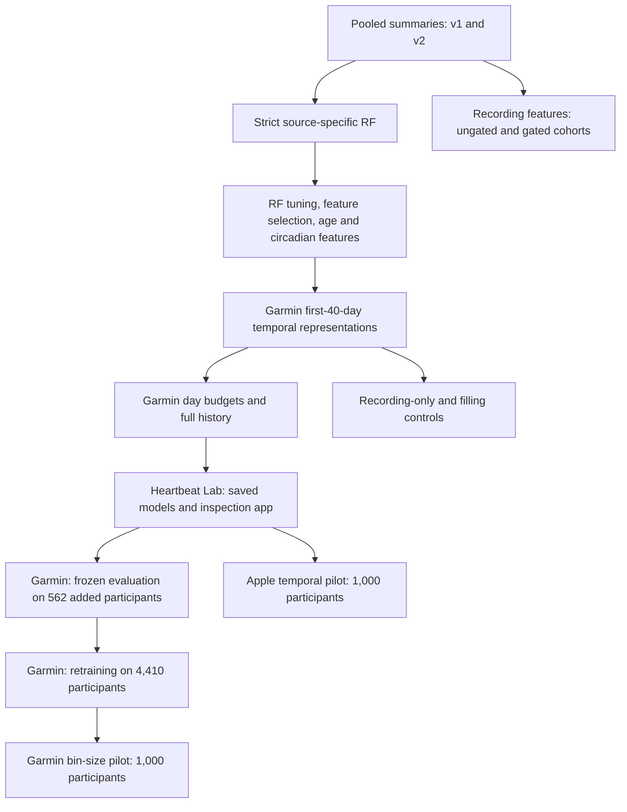

# Experiment map

This map follows the questions investigated in the repository. Arrows indicate development order, not identical cohorts or a causal sequence. The [results reference](../reports/results_reference.md) lists the main numbers. The [audit](../reports/results_audit_2026-10-14.md) records checks against saved predictions.

## Main branches

## Earlier summary and feature experiments

All entries below have saved results. A report may contain historical interpretation that is qualified by the current audit.

| Experiment | Cohort and evaluation | Implementation | Results |
|---|---|---|---|
| Pooled baseline | v1 N=20,485; one 80/10/10 split | [`src/`](../src/) | [`artifacts/model_report.md`](../experiments/artifacts/model_report.md) |
| Pooled v2 | v2 N=20,423; new cohort and split | [`src/config.py`](../src/config.py) | [`artifacts_v2/model_report.md`](../experiments/artifacts_v2/model_report.md) |
| Source-specific RF | Garmin 3,848; Apple 4,446; Samsung 541 | [`src/sidequest/`](../src/sidequest/) | [`sidequest_report.md`](../experiments/artifacts_sq/sidequest_report.md) |
| RF regularization | Same source-specific test sets; tuning within train+validation | [`model_tune.py`](../src/sidequest/model_tune.py) | [`tuned_500_comparison.md`](../experiments/artifacts_sq/tuned_500_comparison.md) |
| Feature selection | 30 repeated participant splits per source | [`feat_sel.py`](../src/sidequest/feat_sel.py) | [`feat_sel_report.md`](../experiments/artifacts_sq/fsplit/feat_sel_report.md) |
| Feature engineering | Same 30 repeated splits | [`feat_eng.py`](../src/sidequest/feat_eng.py) | [`feat_eng_report.md`](../experiments/artifacts_sq/feng/feat_eng_report.md) |
| Informative recording | Ungated N=25,784 and gated N=20,485; 30 repeated splits | [`informative recording experiment`](../experiments/2026-09-20_informative_recording_features/) | Local `output/report.md` and `output/paired_auroc_comparisons.csv` |
| Continuous age | Strict Garmin; 30 repeated splits | [`age experiment`](../experiments/age_vs_agegroup_garmin_2026-09-20/) | [`REPORT.md`](../experiments/age_vs_agegroup_garmin_2026-09-20/results/REPORT.md) |
| R1a circadian features | Strict Garmin; 30 repeated splits | [`run_r1a.py`](../experiments/r1a_circadian_garmin_2026-09-21/run_r1a.py) | [`R1a report`](../experiments/r1a_circadian_garmin_2026-09-21/results/REPORT.md) |
| R1a with balanced allocations | Strict Garmin; 10 repeated allocations | [`run_r1a_allocfolds.py`](../experiments/r1a_allocfolds_garmin_2026-09-21/run_r1a_allocfolds.py) | [`R1a allocation report`](../experiments/r1a_allocfolds_garmin_2026-09-21/results/REPORT.md) |
| Day-level aggregation | Strict Garmin; randomly sampled days from available records | [`run_dayscale.py`](../experiments/dayscale_garmin_2026-09-21/run_dayscale.py) | [`Day-level report`](../experiments/dayscale_garmin_2026-09-21/results/REPORT.md) |
| R1b date-aware features | Strict Garmin; 10 allocations; day and participant estimands | [`run_r1b.py`](../experiments/r1b_dateaware_garmin_2026-09-21/run_r1b.py) | [`R1b report`](../experiments/r1b_dateaware_garmin_2026-09-21/results/REPORT.md) |
| Broader source cohorts | Garmin 5,636; Apple 13,884; Samsung 2,068; 50/50 evaluated in both directions | [`50/50 experiment`](../experiments/2026-09-21_ortools_source_50_50_salutation_rf/) | Local `output/report.md` and `output/model_metrics.csv` |

## Temporal and expanded-cohort experiments

| Experiment | Cohort and evaluation | Implementation | Results |
|---|---|---|---|
| Temporal representations | Strict Garmin N=3,848; first 40 adequate days; 10 allocations | [`run_temporal.py`](../experiments/temporal_garmin/run_temporal.py) | [`Temporal report`](../experiments/temporal_garmin/results/REPORT.md) |
| Day budgets and sampling | Same cohort; first/random days, then full-history pool | [`temporal_garmin/`](../experiments/temporal_garmin/) | [`Days report`](../experiments/temporal_garmin/results/DAYS_SCALING_REPORT.md) |
| Recording-only controls | Same strict cohort; three allocations | [`run_recording.py`](../experiments/recording_structure_garmin/run_recording.py) | [`Recording report`](../experiments/recording_structure_garmin/results/REPORT.md) |
| Filling sensitivity | Same strict cohort; four fitted pipelines, three allocations | [`run_filling.py`](../experiments/filling_sensitivity_garmin/run_filling.py) | [`Filling report`](../experiments/filling_sensitivity_garmin/results/REPORT.md) |
| Selective classification | Saved temporal predictions | [`selective_classification.csv`](../experiments/temporal_garmin/results/selective_classification.csv) | [`Selective classification report`](../experiments/temporal_garmin/results/selective_classification.md) |
| Heartbeat Lab | Strict Garmin; all adequate days; additional small pilots | [`Heartbeat Lab`](../HEARTBEAT_LAB/README.md) | [`Lab audit`](../HEARTBEAT_LAB/AUDIT_REPORT.md), local `artifacts/models/` |
| Frozen-model delta evaluation | 562 Garmin participants failing the strict gate | [`06_evaluate_delta_users.py`](../HEARTBEAT_LAB/scripts/06_evaluate_delta_users.py) | [`Delta results`](../HEARTBEAT_LAB/artifacts/eval_delta_562/delta_evaluation_report.json) |
| Expanded Garmin cohort | N=4,410; all adequate days; 10 repeated holdouts | [`08_run_tier1c_cv.py`](../HEARTBEAT_LAB/scripts/08_run_tier1c_cv.py) | [`Tier1c metrics`](../HEARTBEAT_LAB/artifacts/tier1c_cv_results/tier1c_10_alloc_results.csv) |
| Garmin bin-size pilot | N=1,000; all adequate days; 5 repeated holdouts | [`Garmin binning`](../experiments/garmin_temporal_binning/README.md) | [`Binning metrics`](../experiments/garmin_temporal_binning/artifacts/garmin_binning_benchmark_results.csv) |
| Apple temporal pilot | N=1,000; all adequate days; 5 repeated holdouts | [`Apple pilot`](../experiments/apple_pilot_multirocket/README.md) | [`Pilot metrics`](../experiments/apple_pilot_multirocket/artifacts/pilot_benchmark_results.csv) |

The Garmin and Apple pilots each use 1,000 participants, but they are not matched populations. Their source cohorts, recording histories, and sampling procedures differ. The historical 0.9264 endpoint also has preprocessing exposure across allocations; it should not be treated as the reference against which all later scores are ranked.

## Naming and status

- **B40** is the historical 305-feature participant summary and mask block. **P24** adds hourly profile summaries. **P40** belongs to the earlier date-aware study and is a different feature block.
- **Tier 0** is the 3,848-person strict Garmin cohort. **Delta** is the 562 added participants who failed that gate. **Tier 1c** is their union, N=4,410. These are repository labels for eligibility groups, not validated behavioral phenotypes.
- The ten or five allocations are **repeated holdouts**, not disjoint K-fold test sets. Participants may be tested repeatedly or never tested.
- Unversioned temporal result files contain the corrected run. `temporal_*_v1` archives the zero-sentinel problem; `*_v1mrbug` archives the day-scaling implementation that omitted B40.
- The Garmin binning benchmark is complete. Full Apple scaling, cross-device transfer, additional filling controls, and broader Garmin inclusion are [proposed follow-ups](future_experiments_backlog.md).

Saved reports establish that an analysis produced results. Plans and script names alone do not. Local caches and participant-level files may be absent from a fresh checkout.
